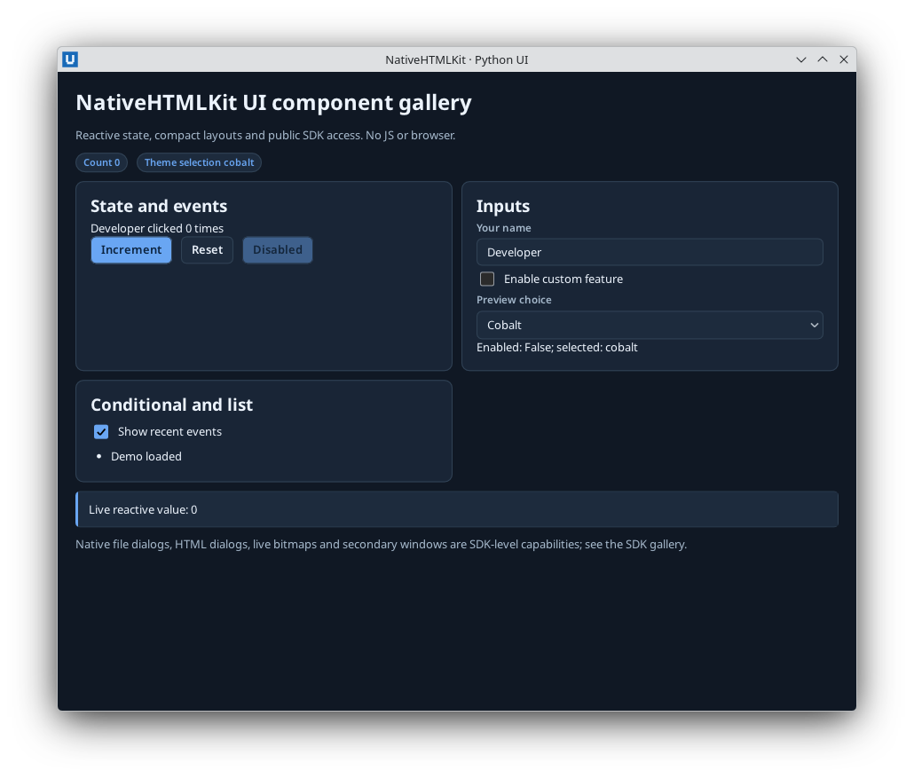
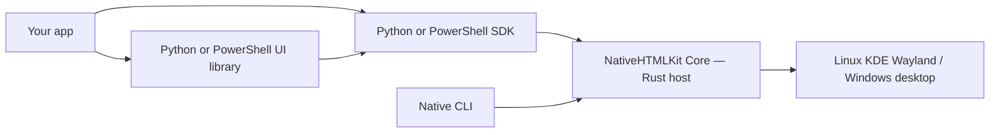

# NativeHTMLKit

**Native desktop apps from HTML and CSS — no browser, JavaScript, Electron, or local web server.** Write the logic in Python or PowerShell, or ask the user a question from a shell script; a small Rust host renders the window and sends your program the events.

> **Real interactive capture:** the [Python UI gallery](examples/python-ui/gallery.py) on KDE Plasma 6.6 Wayland with Core 1.0.3, Python SDK 0.1.2 and UI 0.1.1. More captures of every example are on the [Screenshots and media](docs/demos/screenshots.md) page.

## Documentation

**Read it online: <https://nativehtmlkit.github.io/>** — organised by what you build with, each section with getting started, tutorials, how-to guides, examples (screenshot + full source) and the complete API reference:

| Section | Parts |
|---|---|
| [**UI library**](https://nativehtmlkit.github.io/ui/) | [Python](https://nativehtmlkit.github.io/ui/python/) · [PowerShell](https://nativehtmlkit.github.io/ui/powershell/) |
| [**SDK**](https://nativehtmlkit.github.io/sdk/) | [Python](https://nativehtmlkit.github.io/sdk/python/) · [PowerShell](https://nativehtmlkit.github.io/sdk/powershell/) |
| [**CLI**](https://nativehtmlkit.github.io/cli/) | [Linux](https://nativehtmlkit.github.io/cli/linux/) · [Windows](https://nativehtmlkit.github.io/cli/windows/) · [Reference](https://nativehtmlkit.github.io/cli/reference/) |
| Shared | [Getting started](docs/getting-started/index.md) · [Linux and Windows](docs/getting-started/platforms.md) · [Concepts](docs/concepts/index.md) · [Reference](docs/reference/index.md) · [Capability matrix](docs/capabilities/matrix.md) · [Limitations](docs/capabilities/limitations.md) |

Python and PowerShell mirror each other one to one (same tutorials, guides and examples). The product pages are written in the repository that owns each API and imported into [`docs/`](docs/index.md) by [`scripts/import-docs.py`](scripts/import-docs.py); every example is run against the released packages by its owning repository's harness ([Examples and verification](docs/reference/examples.md)).

## Install

| Entry point | Install | Version |
|---|---|---|
| Python SDK | `pip install nativehtmlkit` ([PyPI](https://pypi.org/project/nativehtmlkit/)) | 0.1.2 |
| Python UI | `pip install nativehtmlkit_ui` ([PyPI](https://pypi.org/project/nativehtmlkit_ui/)) | 0.1.1 (early release) |
| PowerShell SDK | `Install-Module NativeHTMLKit` ([Gallery](https://www.powershellgallery.com/packages/NativeHTMLKit)) | 0.1.2 |
| PowerShell UI | `Install-Module NativeHTMLKit.UI` ([Gallery](https://www.powershellgallery.com/packages/NativeHTMLKit.UI)) | 0.1.1 (early release) |
| CLI | archive from [GitHub releases](https://github.com/nativehtmlkit/nativehtmlkit-cli/releases) | 0.1.2 |
| Demo (every example, one window) | `pip install nativehtmlkit-demo` ([PyPI](https://pypi.org/project/nativehtmlkit-demo/)) or `Install-Module NativeHTMLKit.Demo` ([Gallery](https://www.powershellgallery.com/packages/NativeHTMLKit.Demo)), then `nativehtmlkit-demo` / `Start-NativeHTMLKitDemo` | 0.1.0 |

All of them bundle the native host, Core 1.0.3 (wire protocol v1, stable).

**Scope:** Linux KDE Plasma on Wayland and Windows are the target desktops. Python 3.10+ (the Linux wheel needs glibc 2.39+), PowerShell 7.2+ on Linux and Windows, Windows PowerShell 5.1 on Windows. See [known limitations](docs/capabilities/limitations.md).

## The architecture in one picture

The UI libraries provide convenience components; the SDKs give direct access to windows and documents; Core renders. The CLI is independent. Each API is documented in the repository that implements it:

| Repository | What it owns | Version documented |
|---|---|---|
| [Core](https://github.com/nativehtmlkit/nativehtmlkit-core) | Native host, renderer, wire protocol | 1.0.3 |
| [CLI](https://github.com/nativehtmlkit/nativehtmlkit-cli) | `select`, `view`, `form` commands | 0.1.2 |
| [Python SDK](https://github.com/nativehtmlkit/nativehtmlkit-python) | Python application/window/document API | 0.1.2 |
| [PowerShell SDK](https://github.com/nativehtmlkit/nativehtmlkit-powershell) | PowerShell commands and host lifecycle | 0.1.2 |
| [UI](https://github.com/nativehtmlkit/nativehtmlkit_ui) | Python/PowerShell reactive components | 0.1.1 (early release) |

## This repository

- `docs/` — the documentation site source ([Zensical](https://zensical.org), configured in `zensical.toml`).
- `examples/` — the tested examples and the four capability galleries.
- `capabilities.json` — the source of the generated [capability matrix](docs/capabilities/matrix.md) (`scripts/generate-capabilities.py`).
- `scripts/test-examples.py` — runs every example headlessly against the released packages; `scripts/sync-snippets.py` copies the examples into the pages (`--check` verifies).
- `skills/` — [agent skills](skills/README.md) for SDK and UI development, mirrored from the owning repositories.

NativeHTMLKit is not a web UI framework or a plugin platform. Bug and feature tracking for the ecosystem is coordinated centrally; released API documentation lives with the owning source repository.
