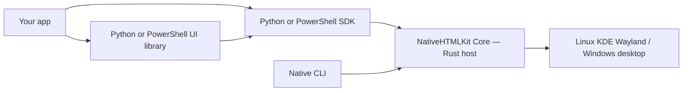

# NativeHTMLKit

**Native desktop apps from HTML and CSS — no browser, JavaScript, Electron, or local web server.** Write application logic in Python or PowerShell, or open native selectors and forms directly from a shell command.

> **Illustrative placeholder, not a captured screenshot.** A reproducible screenshot workflow is included under `scripts/media/` in the Project workspace. Replace the illustration only with a sanitized real Linux/Windows capture.

## Choose your first step

| I want to… | Start here |
|---|---|
| [Install Python SDK on PyPI](https://pypi.org/project/nativehtmlkit/) | [Python in five minutes](docs/getting-started/python.md) |
| [Install PowerShell SDK from Gallery](https://www.powershellgallery.com/packages/NativeHTMLKit) | [PowerShell in five minutes](docs/getting-started/powershell.md) |
| Create a **Python** native window | [Python in five minutes](docs/getting-started/python.md) |
| Build a reactive **Python UI** | [Python UI tutorial](docs/getting-started/python-ui.md) |
| Create a **PowerShell** native window | [PowerShell in five minutes](docs/getting-started/powershell.md) |
| Build a reactive **PowerShell UI** | [PowerShell UI tutorial](docs/getting-started/powershell-ui.md) |
| Open a native selection from Bash | [CLI tutorial](docs/tutorials/cli-selection.md) |
| Explore every component | [Runnable demo galleries](examples/README.md) |
| Check language/OS support | [Capability matrix](docs/capabilities/matrix.md) |
| Give an agent the correct API instructions | [Skills](skills/README.md) |

## The architecture in one picture

The UI libraries provide convenience controls; the SDKs give direct native windows and document APIs; Core does the rendering. The CLI is independent. The public API is documented where it is implemented, not duplicated here.

## Source repositories

| Repository | What it owns | Version at documentation baseline |
|---|---|---|
| [Core](https://github.com/nativehtmlkit/nativehtmlkit-core) | Native host, renderer, wire protocol | 1.0.3 |
| [CLI](https://github.com/nativehtmlkit/nativehtmlkit-cli) | Select, view, form commands | 0.1.2 |
| [Python SDK](https://github.com/nativehtmlkit/nativehtmlkit-python) | Python host/window/document API | 0.1.2 |
| [PowerShell SDK](https://github.com/nativehtmlkit/nativehtmlkit-powershell) | PowerShell cmdlets and host lifecycle | 0.1.2 |
| [UI](https://github.com/nativehtmlkit/nativehtmlkit_ui) | Python/PowerShell reactive components | 0.1.1 (early release) |

**Scope:** Linux KDE Wayland and Windows are the current target desktops. Python 3.10+, PowerShell 7.2+ (Linux/Windows), Windows PowerShell 5.1 (Windows only). The current Linux SDK wheel has a glibc 2.39 floor. See [known limitations](docs/capabilities/limitations.md).

## Learn and contribute

- [Documentation home](docs/index.md) — tutorials, how-to and explanations.
- [Why native rendering?](docs/concepts/why-native.md) — design goals and tradeoffs.
- [Interactive capability gallery](examples/README.md) — four source demos to run locally.
- [Agent skills](skills/README.md) — installable guides for SDK and UI development.

The project is not a web UI framework or a plugin platform. Bug and feature tracking is coordinated privately in the NativeHTMLKit Project repository; released API documentation lives with the owning source repository.
