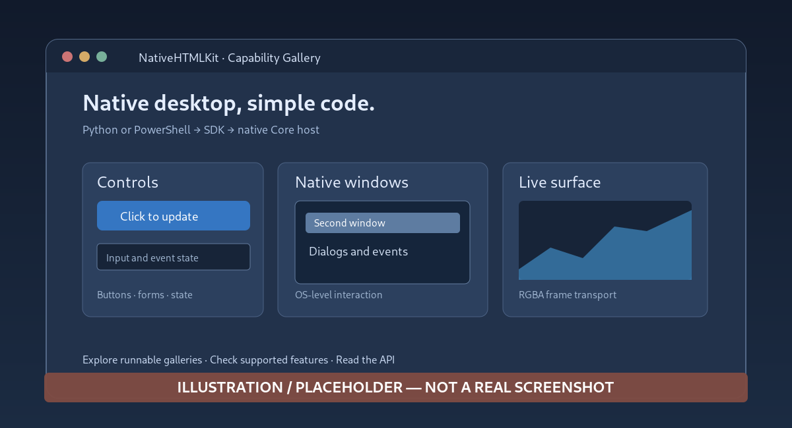
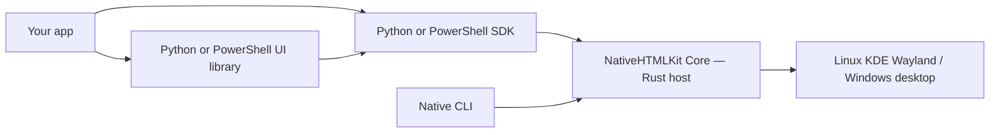

# NativeHTMLKit

**Native desktop apps from HTML and CSS — no browser, JavaScript, Electron, or local web server.** Write the logic in Python or PowerShell, or ask the user a question from a shell script; a small Rust host renders the window and sends your program the events.

> **Illustrative placeholder, not a captured screenshot.** Real Linux/Windows captures replace it only after interactive validation; see [Screenshots and media](docs/demos/screenshots.md).

## Documentation

The documentation site is built from [`docs/`](docs/index.md) and follows four kinds of pages:

| | Start here |
|---|---|
| **Getting started** — install and open a first window | [Python SDK](docs/getting-started/python.md) · [Python UI](docs/getting-started/python-ui.md) · [PowerShell SDK](docs/getting-started/powershell.md) · [PowerShell UI](docs/getting-started/powershell-ui.md) · [CLI](docs/getting-started/cli.md) · [Which one?](docs/getting-started/choose.md) · [Requirements](docs/getting-started/requirements.md) |
| **Tutorials** — build a complete app step by step | [Notes (Python)](docs/tutorials/python-notes.md) · [Expenses (Python UI)](docs/tutorials/python-ui-expenses.md) · [Process dashboard (PowerShell)](docs/tutorials/powershell-process-dashboard.md) · [Settings editor (PowerShell UI)](docs/tutorials/powershell-ui-settings.md) · [Git branch picker (CLI)](docs/tutorials/cli-branch-picker.md) |
| **How-to guides** — solve one task | [Events](docs/how-to/handle-events.md) · [Update the page](docs/how-to/update-the-page.md) · [Forms](docs/how-to/forms.md) · [Windows](docs/how-to/multiple-windows.md) · [File dialogs](docs/how-to/file-dialogs.md) · [HTML dialogs](docs/how-to/html-dialogs.md) · [Clipboard](docs/how-to/clipboard.md) · [Background work](docs/how-to/background-work.md) · [Live charts](docs/how-to/live-bitmap-charts.md) · [CSS](docs/how-to/styling.md) · [UI themes](docs/how-to/theming-ui.md) · [Distribute](docs/how-to/distribute.md) · [Troubleshoot](docs/how-to/troubleshooting.md) · [Accessibility](docs/how-to/accessibility.md) |
| **Concepts** — understand the design | [Architecture](docs/concepts/architecture.md) · [Lifecycle](docs/concepts/lifecycle.md) · [Threading](docs/concepts/threading.md) · [Documents and handles](docs/concepts/documents-and-handles.md) · [Security](docs/concepts/security.md) · [Why native?](docs/concepts/why-native.md) |
| **Reference** — look things up | [API references by repository](docs/reference/index.md) · [Capability matrix](docs/capabilities/matrix.md) · [Limitations](docs/capabilities/limitations.md) · [Glossary](docs/reference/glossary.md) · [FAQ](docs/reference/faq.md) |

Every code sample is a file in [`examples/`](examples/README.md) that [`scripts/test-examples.py`](scripts/test-examples.py) runs against the released packages; see [Examples and verification](docs/reference/examples.md).

## Install

| Entry point | Install | Version |
|---|---|---|
| Python SDK | `pip install nativehtmlkit` ([PyPI](https://pypi.org/project/nativehtmlkit/)) | 0.1.2 |
| Python UI | `pip install nativehtmlkit_ui` ([PyPI](https://pypi.org/project/nativehtmlkit_ui/)) | 0.1.1 (early release) |
| PowerShell SDK | `Install-Module NativeHTMLKit` ([Gallery](https://www.powershellgallery.com/packages/NativeHTMLKit)) | 0.1.2 |
| PowerShell UI | `Install-Module NativeHTMLKit.UI` ([Gallery](https://www.powershellgallery.com/packages/NativeHTMLKit.UI)) | 0.1.1 (early release) |
| CLI | archive from [GitHub releases](https://github.com/nativehtmlkit/nativehtmlkit-cli/releases) | 0.1.2 |

All of them bundle the native host, Core 1.0.3 (wire protocol v1, stable).

**Scope:** Linux KDE Plasma on Wayland and Windows are the target desktops. Python 3.10+ (the Linux wheel needs glibc 2.39+), PowerShell 7.2+ on Linux and Windows, Windows PowerShell 5.1 on Windows. See [known limitations](docs/capabilities/limitations.md).

## The architecture in one picture

The UI libraries provide convenience components; the SDKs give direct access to windows and documents; Core renders. The CLI is independent. Each API is documented in the repository that implements it:

| Repository | What it owns | Version documented |
|---|---|---|
| [Core](https://github.com/nativehtmlkit/nativehtmlkit-core) | Native host, renderer, wire protocol | 1.0.3 |
| [CLI](https://github.com/nativehtmlkit/nativehtmlkit-cli) | `select`, `view`, `form` commands | 0.1.2 |
| [Python SDK](https://github.com/nativehtmlkit/nativehtmlkit-python) | Python application/window/document API | 0.1.2 |
| [PowerShell SDK](https://github.com/nativehtmlkit/nativehtmlkit-powershell) | PowerShell commands and host lifecycle | 0.1.2 |
| [UI](https://github.com/nativehtmlkit/nativehtmlkit_ui) | Python/PowerShell reactive components | 0.1.1 (early release) |

## This repository

- `docs/` — the documentation site source ([Zensical](https://zensical.org), configured in `zensical.toml`).
- `examples/` — the tested examples and the four capability galleries.
- `capabilities.json` — the source of the generated [capability matrix](docs/capabilities/matrix.md) (`scripts/generate-capabilities.py`).
- `scripts/test-examples.py` — runs every example headlessly against the released packages; `scripts/sync-snippets.py` copies the examples into the pages (`--check` verifies).
- `skills/` — [agent skills](skills/README.md) for SDK and UI development, mirrored from the owning repositories.

NativeHTMLKit is not a web UI framework or a plugin platform. Bug and feature tracking for the ecosystem is coordinated centrally; released API documentation lives with the owning source repository.
