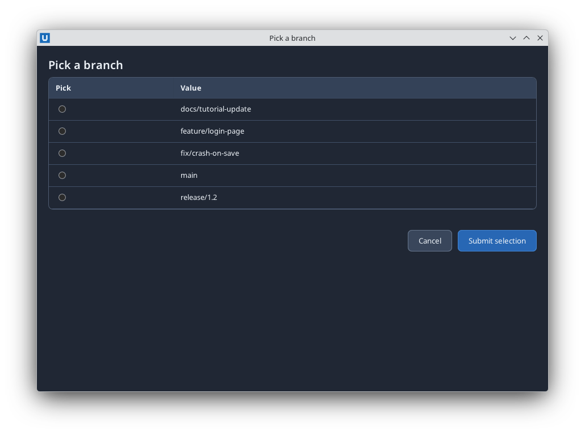

<!-- GENERATED by scripts/import-docs.py; edit the generator or the owning repository. -->
# Branch picker, step 1 (tutorial)

Offer the local branches in a list and report the choice and exit status.

*Same example in Windows: [Branch picker, step 1 (tutorial)](../../windows/examples/branch-picker-step1.md)*



*Real capture on KDE Plasma 6.6 Wayland with the released packages.*

**What it teaches:** lines input; capturing stdout; exit statuses 0, 2, 124.

## Run it

```bash
bash tutorial-branch-picker/step1-pick.sh [--timeout SECONDS]
```

## Source: `tutorial-branch-picker/step1-pick.sh`

[View on GitHub](https://github.com/nativehtmlkit/nativehtmlkit-cli/blob/main/examples/tutorial-branch-picker/step1-pick.sh)

```bash
#!/usr/bin/env bash
# Branch picker tutorial, step 1: offer the local branches in a native list and report the choice.
#
# Teaches: piping lines into `nativehtmlkit select`, capturing stdout, and the exit statuses
#          0 (chosen), 2 (cancelled), 124 (--timeout expired) and anything else (error).
# Run:     bash step1-pick.sh [--timeout SECONDS]     (inside a Git work tree)
# Guide:   docs/linux/tutorial-branch-picker.md (step 1 of 2)
set -euo pipefail

status=0
choice=$(git for-each-ref --format='%(refname:short)' refs/heads/ \
  | nativehtmlkit select --title "Pick a branch" "$@") || status=$?

case $status in
  0) echo "You chose: $choice" ;;
  2) echo "Cancelled" >&2 ;;
  124) echo "No choice made in time" >&2 ;;
  *) echo "nativehtmlkit select failed with exit status $status" >&2 ;;
esac
exit "$status"
```
