<!-- GENERATED by scripts/import-docs.py; edit the generator or the owning repository. -->
# Linux examples

Every example is a complete program, verified against the real NativeHTMLKit host. Open one to see a screenshot, how to run it and its full source.

| Example | What it does | |
|---|---|---|
| [Pick a Git branch](pick-git-branch.md) | Switch to a branch chosen from a table of recent branches with their last commit. | 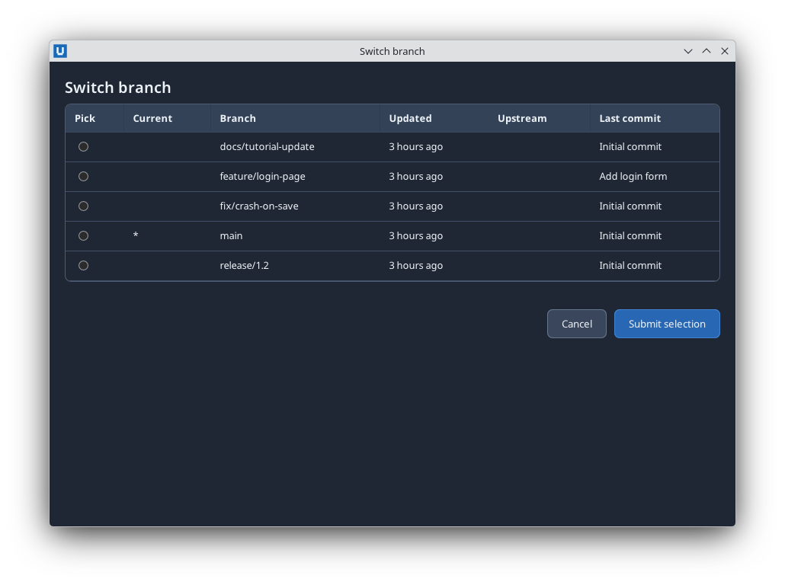 |
| [Delete files with confirmation](delete-files.md) | Tick files, confirm in a second window, then delete exactly the ticked files. | 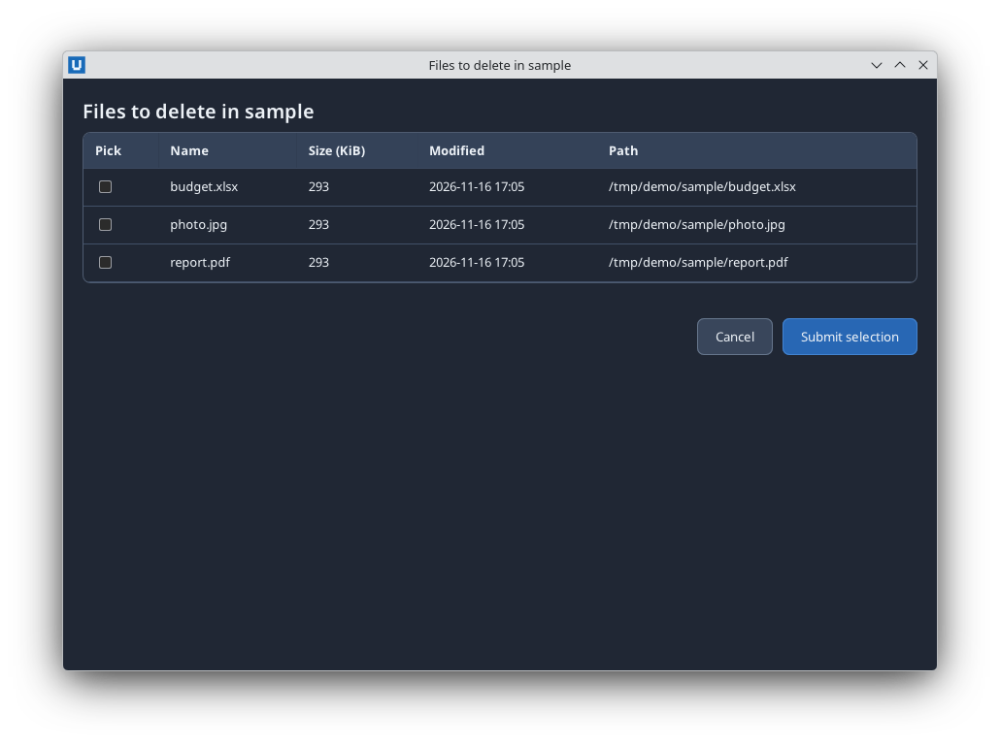 |
| [Choose processes to stop](processes.md) | Pick processes in a table and stop or signal exactly those. | 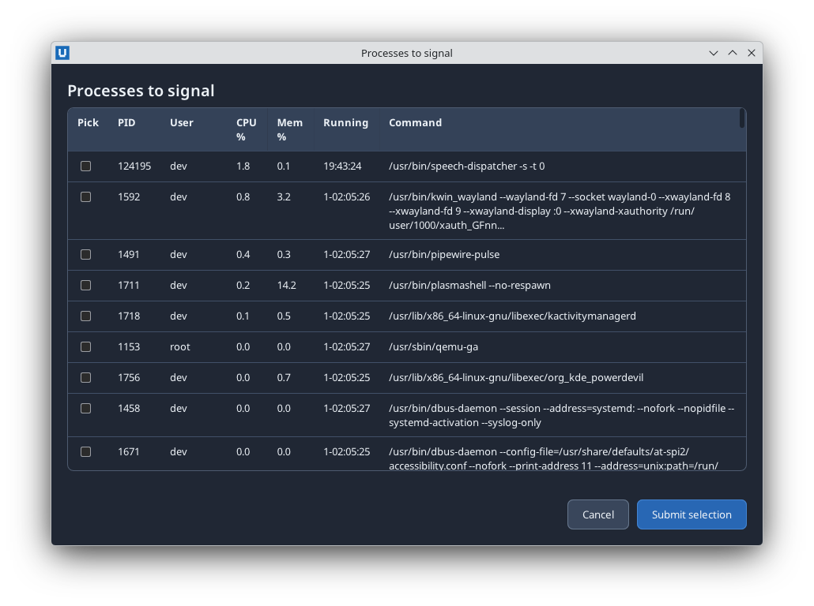 |
| [Choose a Docker container](pick-container.md) | Pick a container, then show its logs, restart, stop it or open a shell. | 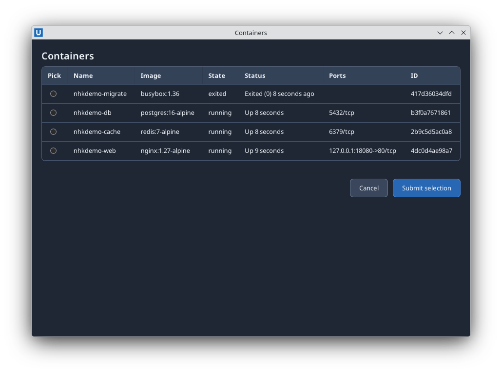 |
| [Choose from JSON API output](pick-from-api.md) | Reshape a REST response, pick issues and print their URLs. | 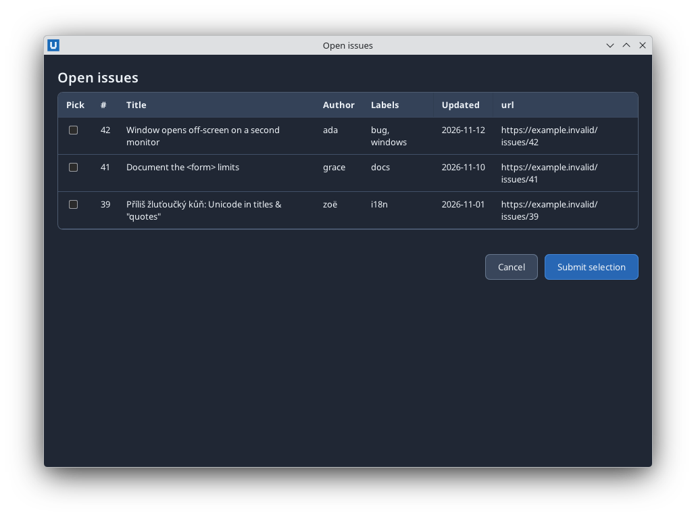 |
| [Review and export CSV reports](csv-report.md) | View a CSV report, or export the rows you tick to a new CSV file. | 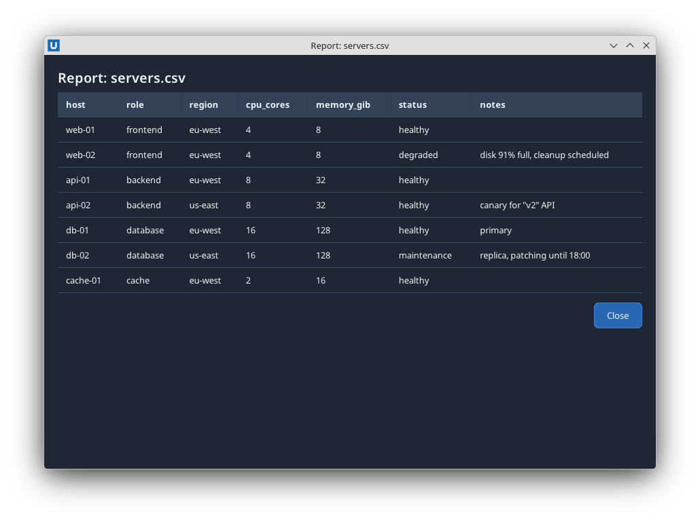 |
| [View logs](view-logs.md) | Show the end of a text or JSON-lines log (Windows: also the event log). | 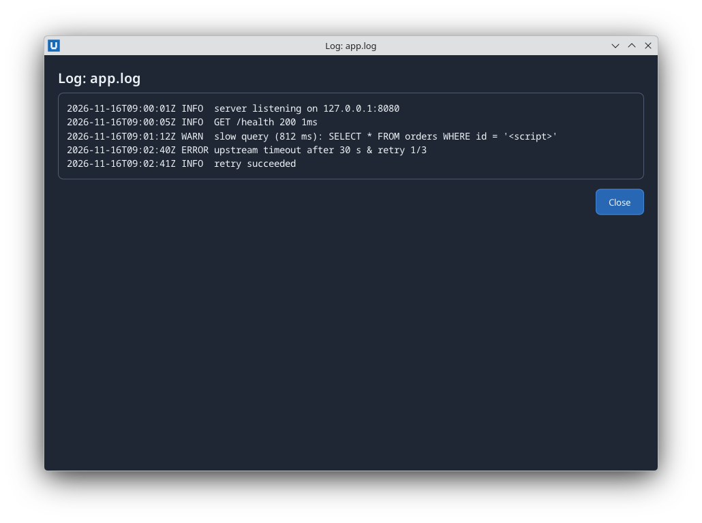 |
| [Search only the files you tick](search-selected.md) | Tick files in a window, then search only those for a pattern. | 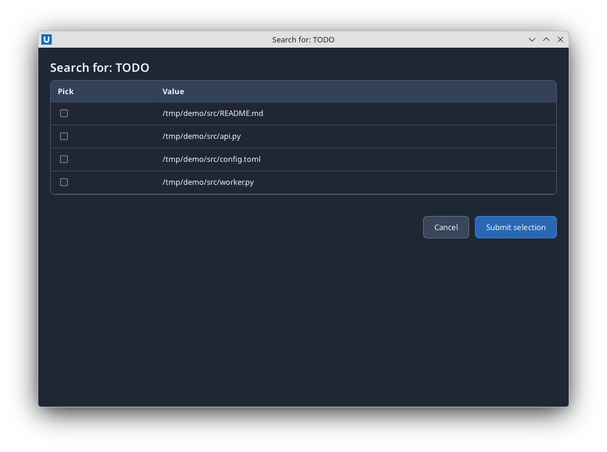 |
| [A deployment form](deploy-form.md) | Collect validated deployment parameters, confirm production, return them typed. | 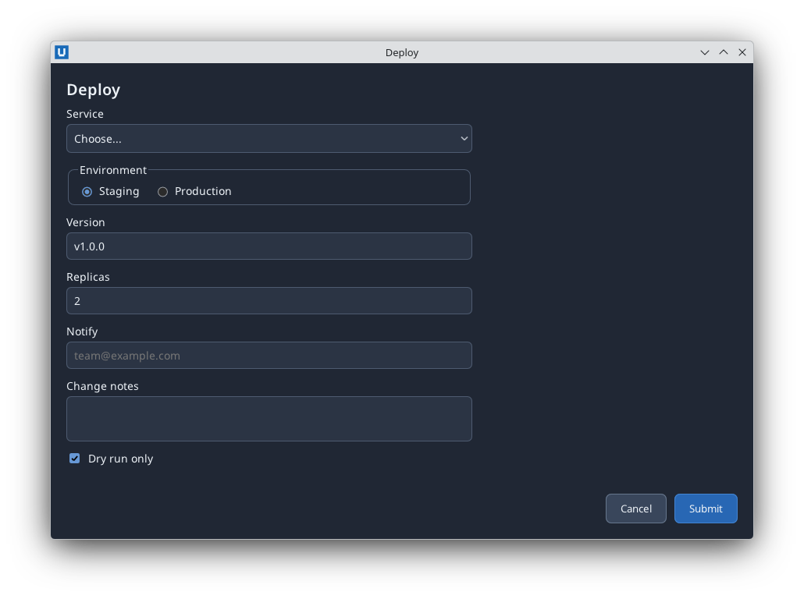 |
| [Choose a time zone in a light theme](pick-timezone.md) | Pick one time zone from a long list in a window restyled with --css. | 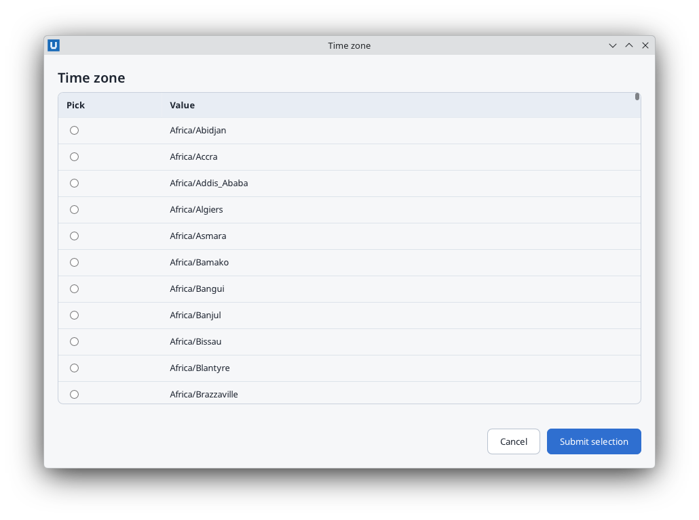 |
| [Project picker (tutorial)](project-picker.md) | Bookmark project directories, pick one to jump to, list and remove them. | 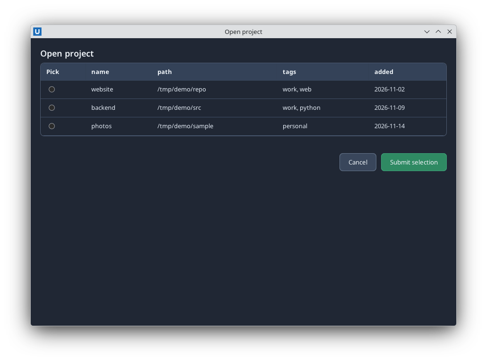 |
| [Branch picker, step 1 (tutorial)](branch-picker-step1.md) | Offer the local branches in a list and report the choice and exit status. | 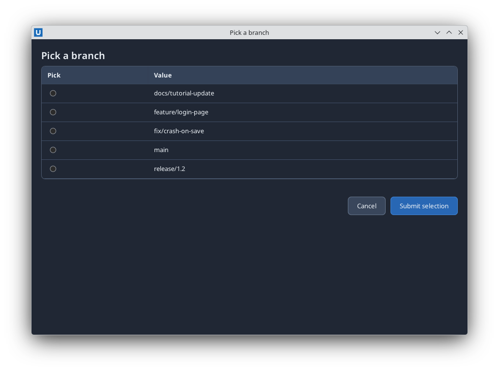 |
| [git-pick: switch and delete branches (tutorial)](branch-picker.md) | Switch to a branch from a table, or delete merged branches ticked in a list. | 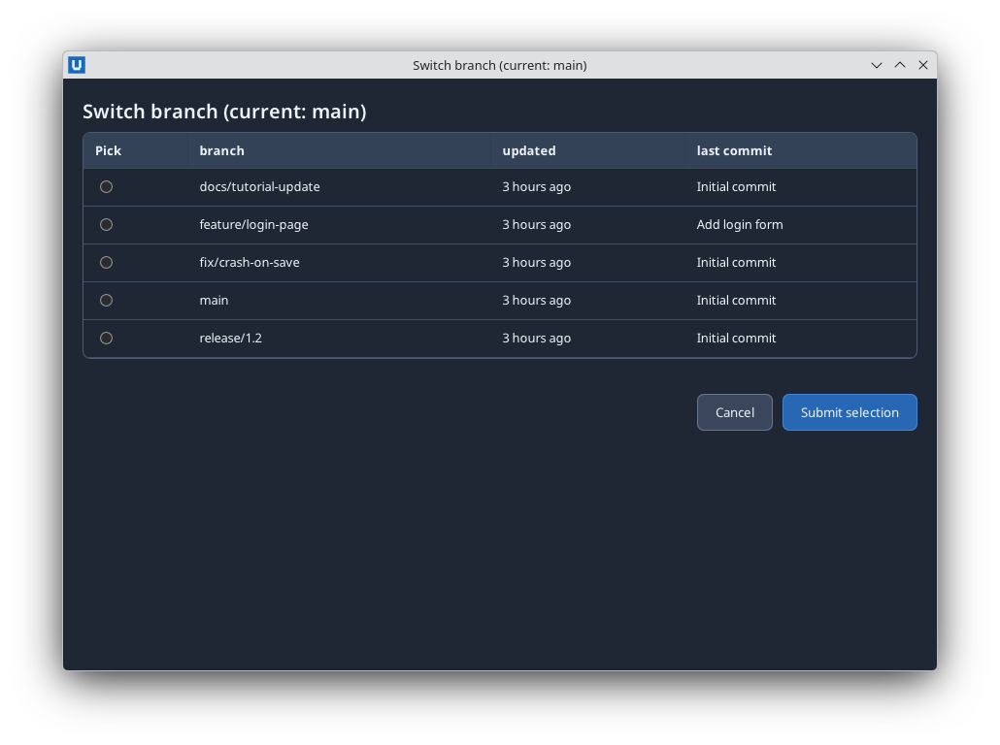 |
