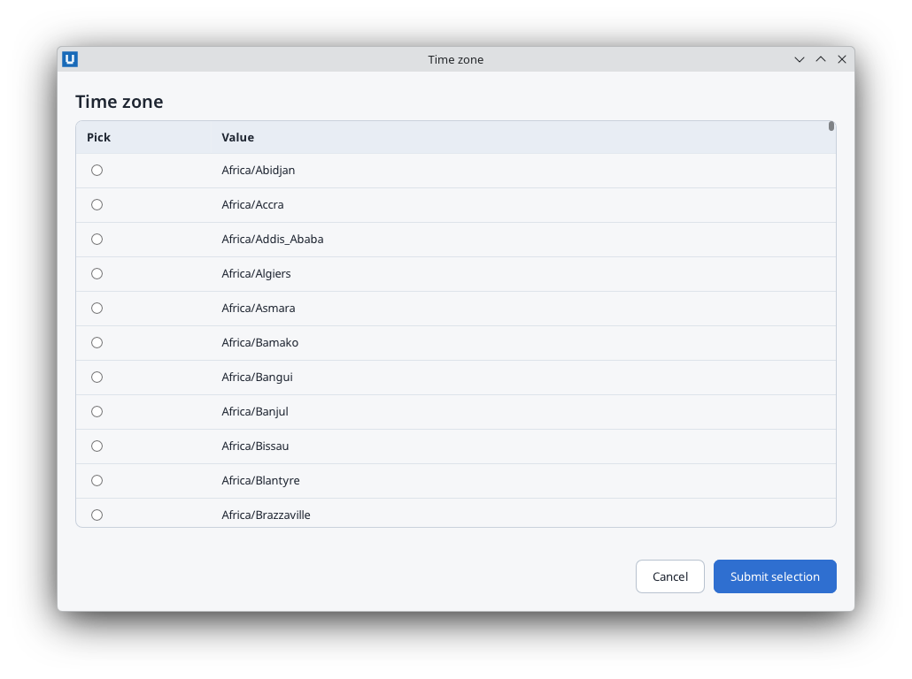

<!-- GENERATED by scripts/import-docs.py; edit the generator or the owning repository. -->
# Choose a time zone in a light theme

Pick one time zone from a long list in a window restyled with --css.

*Same example in Windows: [Choose a time zone in a light theme](../../windows/examples/pick-timezone.md)*



*Real capture on KDE Plasma 6.6 Wayland with the released packages.*

**What it teaches:** --css themes via custom properties; a single value from a long list.

## Run it

```bash
./pick-timezone.sh
```

## Source: `pick-timezone.sh`

[View on GitHub](https://github.com/nativehtmlkit/nativehtmlkit-cli/blob/main/examples/pick-timezone.sh)

```bash
#!/usr/bin/env bash
# pick-timezone.sh - choose a time zone from a long list in a light-themed window.
#
# Teaches: restyling the CLI's window with a trusted --css file (css/light.css overrides the
# page's colour custom properties) and using a single `lines` selection as a value.
#
# Run:   ./pick-timezone.sh                  prints e.g. Europe/Prague
#        TZ=$(./pick-timezone.sh) date
# Needs: nativehtmlkit on PATH; timedatectl or /usr/share/zoneinfo.
# Exit:  0 printed the zone, 2 cancelled, 124 no decision in time, 1 error.
set -euo pipefail

here=$(cd -- "$(dirname -- "${BASH_SOURCE[0]}")" && pwd)

zones() {
  if timedatectl list-timezones 2>/dev/null; then return; fi
  (cd /usr/share/zoneinfo && find . -type f -name '[A-Z]*' | sed 's|^\./||' | grep '/' | grep -v '^right/\|^posix/' | sort)
}

zones | head -n 2000 |
  nativehtmlkit select --title "Time zone" --css "$here/css/light.css"
```
