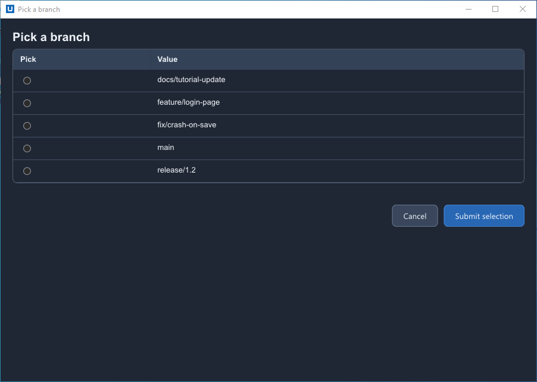

<!-- GENERATED by scripts/import-docs.py; edit the generator or the owning repository. -->
# Branch picker, step 1 (tutorial)

Offer the local branches in a list and report the choice and exit status.

*Same example in Linux: [Branch picker, step 1 (tutorial)](../../linux/examples/branch-picker-step1.md)*



*Real capture on Windows Server 2022 with the released packages.*

**What it teaches:** lines input; capturing stdout; exit statuses 0, 2, 124.

## Run it

```powershell
.\tutorial-branch-picker\step1-pick.ps1 [-Timeout SECONDS]
```

## Source: `tutorial-branch-picker/step1-pick.ps1`

[View on GitHub](https://github.com/nativehtmlkit/nativehtmlkit-cli/blob/main/examples/tutorial-branch-picker/step1-pick.ps1)

```powershell
<#
Branch picker tutorial, step 1: offer the local branches in a native list and report the choice.

Teaches: piping lines into `nativehtmlkit select`, capturing stdout, and the exit statuses
0 (chosen), 2 (cancelled), 124 (-Timeout expired) and anything else (error) through
$LASTEXITCODE. The PowerShell counterpart of step1-pick.sh.

Run:   .\step1-pick.ps1 [-Timeout SECONDS]     (inside a Git work tree)
Guide: docs/windows/tutorial-branch-picker.md (step 1 of 2)
#>
param([double] $Timeout = 0)
$ErrorActionPreference = 'Stop'
$previousEncoding = [Console]::OutputEncoding
[Console]::OutputEncoding = $OutputEncoding = [System.Text.UTF8Encoding]::new($false)
try {
    $extra = @()
    if ($Timeout -gt 0) { $extra = '--timeout', [string] $Timeout }

    $choice = git for-each-ref '--format=%(refname:short)' refs/heads/ |
        nativehtmlkit select --title 'Pick a branch' @extra
    $status = $LASTEXITCODE
    switch ($status) {
        0       { "You chose: $choice" }
        2       { Write-Warning 'Cancelled' }
        124     { Write-Warning 'No choice made in time' }
        default { Write-Warning "nativehtmlkit select failed with exit status $status" }
    }
    exit $status
}
finally {
    [Console]::OutputEncoding = $previousEncoding
}
```
