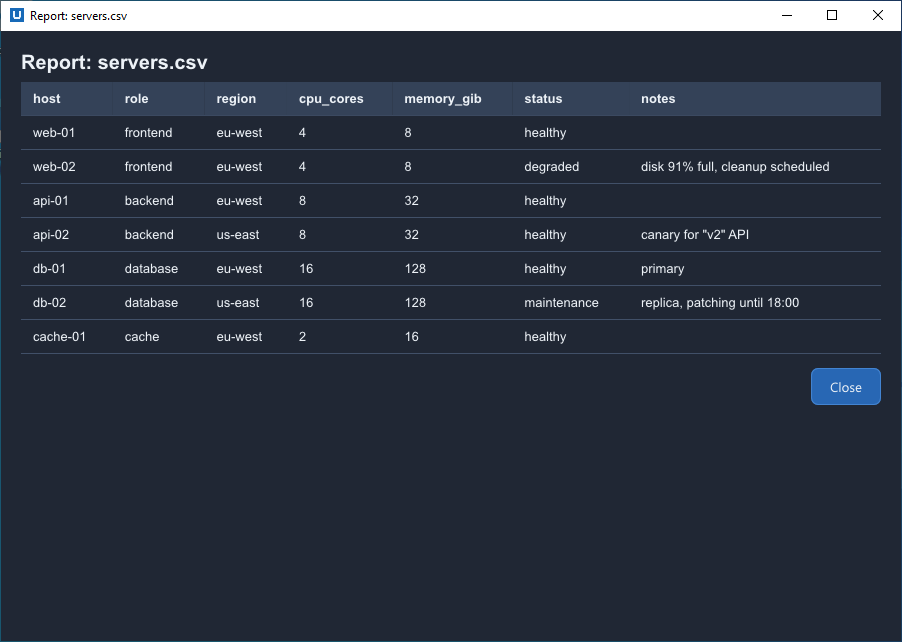

<!-- GENERATED by scripts/import-docs.py; edit the generator or the owning repository. -->
# Review and export CSV reports

View a CSV report, or export the rows you tick to a new CSV file.

*Same example in Linux: [Review and export CSV reports](../../linux/examples/csv-report.md)*



*Real capture on Windows Server 2022 with the released packages.*

**What it teaches:** view; CSV in and out; writing output only after Submit.

## Run it

```powershell
.\csv-report.ps1 -Report data\servers.csv [-Output OUTPUT.csv]
```

## Source: `csv-report.ps1`

[View on GitHub](https://github.com/nativehtmlkit/nativehtmlkit-cli/blob/main/examples/csv-report.ps1)

```powershell
<#
csv-report.ps1 - review a CSV report in a native table, then export only the rows you tick.

Teaches: sending a file's text unchanged to `view`/`select --input-format csv`, getting
correctly re-quoted CSV back (`--output-format csv`), and writing the export as UTF-8
without a BOM only after the user submitted, so Cancel never leaves a half-written file.

Run:   .\csv-report.ps1 -Report data\servers.csv [-Output subset.csv]
Needs: nativehtmlkit on PATH.
Exit:  0 viewed / exported, 2 cancelled, 124 no decision in time, 1 error.
#>
param([Parameter(Mandatory)] [string] $Report, [string] $Output)
$ErrorActionPreference = 'Stop'
$previousEncoding = [Console]::OutputEncoding
[Console]::OutputEncoding = $OutputEncoding = [System.Text.UTF8Encoding]::new($false)
try {
    $text = [IO.File]::ReadAllText((Resolve-Path -LiteralPath $Report).ProviderPath, [Text.Encoding]::UTF8)
    $title = "Report: $(Split-Path -Leaf $Report)"
    if (-not $Output) {
        $text | nativehtmlkit view --input-format csv --title $title
        exit $LASTEXITCODE
    }

    $csv = $text | nativehtmlkit select --multi --input-format csv --output-format csv --title 'Rows to export'
    switch ($LASTEXITCODE) {
        0       { }
        2       { Write-Warning "Cancelled; $Output not written."; exit 2 }
        124     { Write-Warning "No decision in time; $Output not written."; exit 124 }
        default { exit $LASTEXITCODE }
    }
    $target = $ExecutionContext.SessionState.Path.GetUnresolvedProviderPathFromPSPath($Output)
    [IO.File]::WriteAllText($target, (($csv -join "`n") + "`n"), [System.Text.UTF8Encoding]::new($false))
    Write-Host "Wrote $(@($csv).Count - 1) row(s) to $Output"
}
finally {
    [Console]::OutputEncoding = $previousEncoding
}
```
