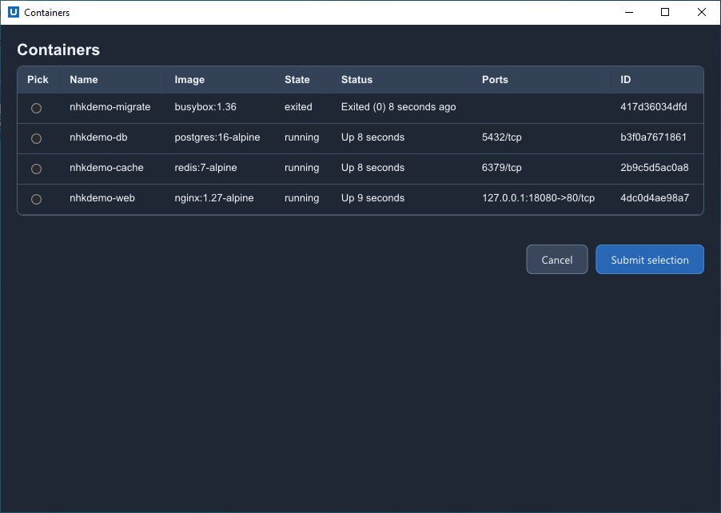

<!-- GENERATED by scripts/import-docs.py; edit the generator or the owning repository. -->
# Choose a Docker container

Pick a container, then show its logs, restart, stop it or open a shell.

*Same example in Linux: [Choose a Docker container](../../linux/examples/pick-container.md)*



*Real capture on Windows Server 2022 with the released packages.*

**What it teaches:** NDJSON from docker ps; chained selections; view for logs.

## Run it

```powershell
.\pick-container.ps1
```

## Source: `pick-container.ps1`

[View on GitHub](https://github.com/nativehtmlkit/nativehtmlkit-cli/blob/main/examples/pick-container.ps1)

```powershell
<#
pick-container.ps1 - choose a Docker container, then choose what to do with it.

Teaches: NDJSON straight from `docker ps --format '{{json .}}'` reshaped into fewer columns,
two chained selections, and `view` for command output.

Run:   .\pick-container.ps1
Needs: nativehtmlkit and docker on PATH.
Exit:  0 action done, 2 cancelled, 124 no decision in time, 1 error.
#>
$ErrorActionPreference = 'Stop'
$previousEncoding = [Console]::OutputEncoding
[Console]::OutputEncoding = $OutputEncoding = [System.Text.UTF8Encoding]::new($false)

function Invoke-Picker {
    $out = $input | nativehtmlkit @args
    if ($LASTEXITCODE -ne 0) { Write-Warning 'No action taken.'; exit $LASTEXITCODE }
    $out -join "`n"
}

try {
    $rows = @(docker ps --all --format '{{json .}}' | ForEach-Object {
        $c = $_ | ConvertFrom-Json
        [pscustomobject]@{ Name = $c.Names; Image = $c.Image; State = $c.State; Status = $c.Status; Ports = $c.Ports; ID = $c.ID } |
            ConvertTo-Json -Compress
    })
    if ($rows.Count -eq 0) { Write-Host 'No containers.'; exit 0 }

    $container = (ConvertFrom-Json -InputObject ($rows | Invoke-Picker select --input-format ndjson --output-format json --title 'Containers'))[0]
    $label = $container.Name.Substring(0, [math]::Min(80, $container.Name.Length))   # --title: at most 128 characters
    $action = 'logs', 'restart', 'stop' | Invoke-Picker select --title "Container $label"

    switch ($action) {
        'logs'    {
            # 2>&1 turns docker's stderr lines into error records; with 'Stop' Windows
            # PowerShell 5.1 would end the script on the first one.
            $ErrorActionPreference = 'Continue'
            docker logs --tail 1000 --timestamps $container.ID 2>&1 | ForEach-Object { "$_" } |
                nativehtmlkit view --title "Logs: $label"
            exit $LASTEXITCODE
        }
        'restart' { docker restart $container.ID }
        'stop'    { docker stop $container.ID }
    }
}
finally {
    [Console]::OutputEncoding = $previousEncoding
}
```
