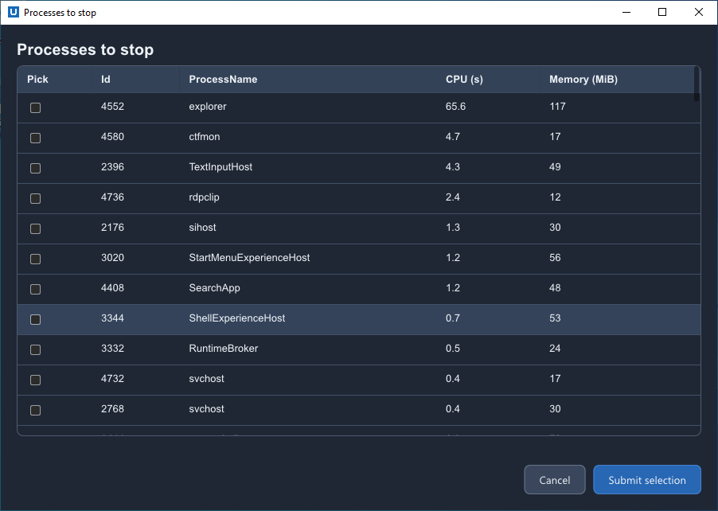

<!-- GENERATED by scripts/import-docs.py; edit the generator or the owning repository. -->
# Choose processes to stop

Pick processes in a table and stop or signal exactly those.

*Same example in Linux: [Choose processes to stop](../../linux/examples/processes.md)*



*Real capture on Windows Server 2022 with the released packages.*

**What it teaches:** process lists as CSV or JSON; CSV/JSON in, JSON out; a second choice for the action.

## Run it

```powershell
.\stop-process.ps1 [-Name PATTERN] [-WhatIf]
```

## Source: `stop-process.ps1`

[View on GitHub](https://github.com/nativehtmlkit/nativehtmlkit-cli/blob/main/examples/stop-process.ps1)

```powershell
<#
stop-process.ps1 - pick processes from a table and stop them.

Teaches: Get-Process -> Select-Object -> ConvertTo-Json as CLI input (choose the columns:
a raw Process object has far more than the 32 columns the CLI accepts), multi-select, and
reading the Id property back from the JSON result.

Run:   .\stop-process.ps1 [-Name notepad*] [-WhatIf]
Needs: nativehtmlkit on PATH. Works on Windows and, with PowerShell 7, on Linux.
Exit:  0 stopped, 2 cancelled, 124 no decision in time, 1 error.
#>
[CmdletBinding(SupportsShouldProcess)]
param([string] $Name = '*')
$ErrorActionPreference = 'Stop'
$previousEncoding = [Console]::OutputEncoding
[Console]::OutputEncoding = $OutputEncoding = [System.Text.UTF8Encoding]::new($false)
try {
    $rows = @(Get-Process -Name $Name -ErrorAction SilentlyContinue |
        Where-Object Id -ne $PID |
        Sort-Object CPU -Descending | Select-Object -First 500 |
        Select-Object Id, ProcessName,
            @{ n = 'CPU (s)'; e = { [math]::Round($_.CPU, 1) } },
            @{ n = 'Memory (MiB)'; e = { [math]::Round($_.WorkingSet64 / 1MB) } })
    if ($rows.Count -eq 0) { Write-Host "No process matches $Name."; exit 0 }

    $json = $rows | ConvertTo-Json -Compress |
        nativehtmlkit select --multi --input-format json --output-format json --title 'Processes to stop'
    if ($LASTEXITCODE -ne 0) { Write-Warning 'Nothing stopped.'; exit $LASTEXITCODE }

    # ForEach-Object unrolls the array: Windows PowerShell 5.1 returns a JSON array as one object.
    foreach ($process in @(ConvertFrom-Json -InputObject ($json -join "`n") | ForEach-Object { $_ })) {
        if ($PSCmdlet.ShouldProcess("$($process.ProcessName) ($($process.Id))", 'Stop process')) {
            Stop-Process -Id $process.Id
        }
    }
}
finally {
    [Console]::OutputEncoding = $previousEncoding
}
```
