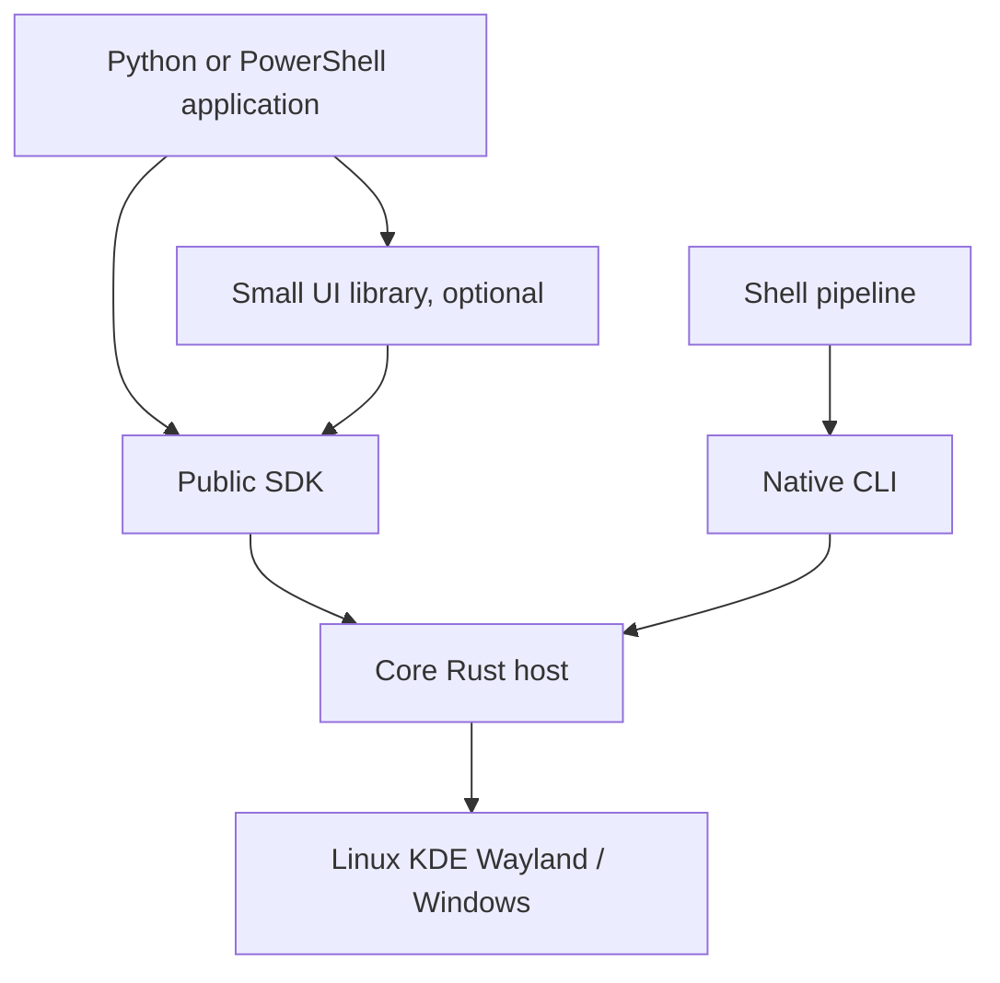

# Architecture — who owns what?

NativeHTMLKit is not a website rendered in a hidden Chromium tab. A Rust native host parses HTML/CSS, handles desktop input and owns native windows. The Python and PowerShell SDKs provide language APIs and manage host transport; the UI library adds a constrained component/state layer, not a second renderer.

**Boundary rule:** UI libraries may call only their public language SDK; an app may access SDK features not wrapped by UI. A missing native primitive belongs in a separate approved feature for Core/SDK, not a UI-side private RPC hack. The CLI independently implements its own host-v1 client.

[Core technical architecture](https://github.com/nativehtmlkit/nativehtmlkit-core/blob/main/docs/ARCHITECTURE.md) · [Python SDK](https://github.com/nativehtmlkit/nativehtmlkit-python/blob/main/docs/ARCHITECTURE.md) · [PowerShell SDK](https://github.com/nativehtmlkit/nativehtmlkit-powershell/blob/main/docs/ARCHITECTURE.md)
