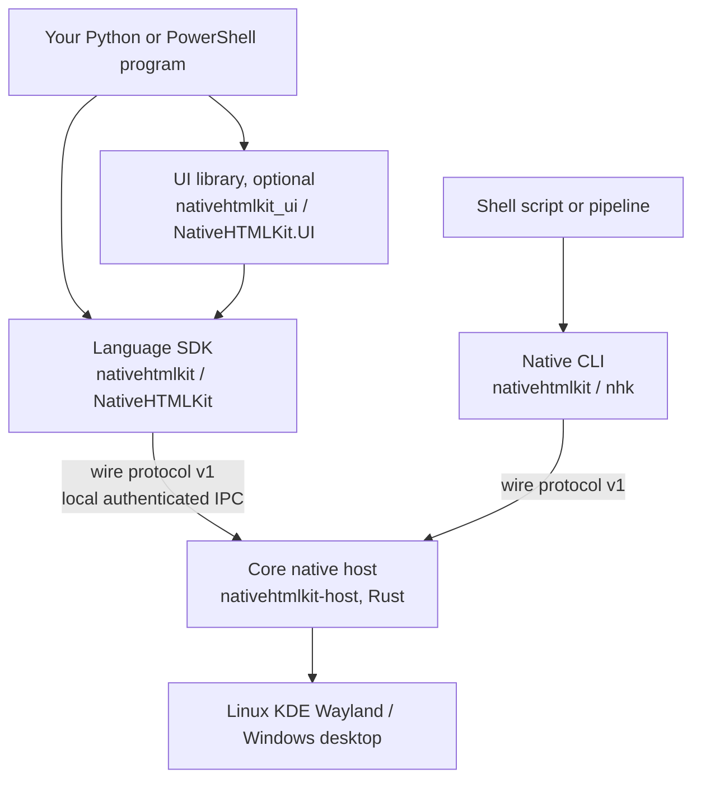

# Architecture — who owns what?

NativeHTMLKit is not a website in a hidden browser tab. A Rust **native host** parses HTML and CSS, lays out and draws the page, owns the native windows, handles keyboard, pointer, IME, accessibility and native dialogs, and reports events to your program. Your program — the **backend** — contains the application logic and sends commands such as “set this element's text” back to the host.

## Components

| Component | Owns | Does not own |
|---|---|---|
| **Core** (`nativehtmlkit-host`) | Native windows, HTML/CSS engine, input, rendering, native dialogs, clipboard, live bitmaps, the wire protocol | Application logic, language APIs |
| **Python SDK** (`nativehtmlkit`) | Python API for applications, windows, documents, nodes, bitmaps; launching the bundled host; diagnostics | Rendering, widgets |
| **PowerShell SDK** (`NativeHTMLKit`) | The same host-level features as exported functions; the event pump and background tasks for PowerShell | Rendering, widgets |
| **UI library** (`nativehtmlkit_ui`, `NativeHTMLKit.UI`) | Reactive state, computed values, a compact component set (layout, text, buttons, inputs, select, checkbox, lists, conditional regions) and themes | Anything the SDK does not expose; native dialogs, extra windows and bitmaps stay SDK calls |
| **CLI** (`nativehtmlkit`, alias `nhk`) | `select`, `view`, `form` and `doctor` commands for shell pipelines, with a stdin/stdout/exit-status contract | General event subscription or scripting |

Each SDK wheel/module and the CLI archive ship the native host they were released with, so a normal install needs no separate Core download.

## The boundary rule

- The UI libraries call **only the public API** of their language SDK. They never talk to Core directly. Your application can mix both: build the main window with the UI library and use the SDK for file dialogs, clipboard, a second window or a live bitmap.
- The **CLI is independent** of the language SDKs: it implements its own protocol v1 client and bundles its own host.
- A feature that Core does not expose cannot be added in a UI library or an application through private calls; it belongs in Core and the SDKs.

## The wire protocol

SDKs and the CLI talk to the host over a private local channel (a Unix-domain socket on Linux, a named pipe on Windows), authenticated with a per-launch token. Messages are length-prefixed JSON-RPC 2.0. **Protocol v1 is the public, stable contract since Core 1.0.3**: within v1, framing, method and operation names, parameter names and types, error codes and lifecycle ordering never change; new methods, operations, optional parameters and result members may be added, and clients must ignore what they do not know. The authoritative description is the [Core protocol README](https://github.com/nativehtmlkit/nativehtmlkit-core/blob/main/protocol/README.md).

Most applications never see the protocol: they use the SDK. Low-level escape hatches exist (`Document.command(op, ...)` in Python, `Invoke-NativeHTMLKitDocumentCommand` in PowerShell) for documented document operations that have no convenience wrapper.

## Where to read more

- [Core architecture](https://github.com/nativehtmlkit/nativehtmlkit-core/blob/main/docs/ARCHITECTURE.md)
- [Process and lifecycle model](lifecycle.md) · [Threading and callbacks](threading.md) · [Security model](security.md)
- [Reference index](../reference/index.md) for each repository's API documentation
