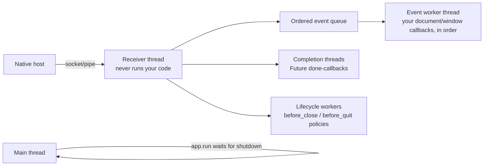

# Threading and callbacks

The host renders and handles input on its own threads; your program only receives events and sends commands. *Where* your callbacks run differs between Python and PowerShell, and it decides what you may block on.

## Python SDK

- **The transport reader never runs application code.** Callbacks may therefore make synchronous calls to the host (`doc.set_text(...)` inside a click handler is normal).
- **Document and window events are delivered in order on one event worker thread.** A slow handler delays every later event. The queue is bounded (128 queued notifications); events the SDK had to drop because a callback blocked are counted in `app.rpc.dropped_notifications`, and events the *host* dropped because the process stopped reading appear in `app.host_diagnostics()["dropped_notifications"]`.
- **Close/quit policies are answered on separate request workers**, so a busy event handler does not stall lifecycle control.
- **`call_async` futures complete on their own short-lived `nativehtmlkit-completion` thread.** Done-callbacks may call the host synchronously or wait for other futures.
- **SDK calls are allowed from any thread**, including your own `threading.Thread` workers. Use that for long work: compute in a worker and push results with `doc.set_text(...)` and friends.

**Native dialogs inside an event handler.** `window.open_files()`, `save_file()` and `choose_folder()` wait for the user by default (`wait=True`, no deadline). Called from an event handler, that blocks the event worker — every later click waits until the dialog closes. Pass `wait=False` to get a `Future` and handle the result in `future.add_done_callback(...)`; `future.cancel()` asks the host to close the dialog. See [file dialogs](../python/sdk/guides/file-dialogs.md) ([PowerShell](../powershell/sdk/guides/file-dialogs.md)).

The optional `async_adapter()` exposes the same connection to an asyncio loop; it does not change who renders.

## Python UI library

- Build the component tree on the main thread **before** `ui.mount(app)`; afterwards the tree is fixed and you change it only through state.
- Each mounted UI has one **owner thread** that performs all runtime DOM writes. SDK event workers only enqueue events for it, and state changes are batched into few document updates.
- `State.set(...)` may be called from any thread; bindings marshal the resulting DOM update to the owner. `ui.post(fn, *args)` runs a function on the owner thread (it raises if the bounded queue is full).
- **Known limitation:** a `computed(...)` value can race when several threads change its dependencies at the same time. Change related state from one thread (for example, post results to the owner with `ui.post`). See [limitations](../capabilities/limitations.md).
- `ui.diagnostics` reports update counts, dropped events, errors and whether the DOM may be out of sync after a failed write.

## PowerShell SDK

PowerShell has one runspace per script and no background event thread. The SDK runs everything on **your runspace** through an event pump:

- `Wait-NativeHTMLKit -Application $app -UntilShutdown` pumps messages and runs your scriptblocks until shutdown. Without `-UntilShutdown` it handles what is queued (waiting up to `-TimeoutMilliseconds`) and returns, which lets you write your own loop.
- **Every waiting SDK call also pumps.** While a command such as `Set-NativeHTMLKitDocumentText` or a blocking `Show-NativeHTMLKitFileDialog` waits for its reply, host requests (close/quit policies) are still answered.
- **Callbacks never nest.** A notification that arrives while one of your callbacks is running is deferred and delivered after it returns (up to 128 deferred notifications; further ones are dropped and counted). A blocking file dialog inside a click handler is therefore safe for lifecycle, but other clicks wait until it closes.
- Callback nesting is limited to 32 levels; `break`/`continue` used outside a loop inside a callback is stopped at the callback boundary.

### Scriptblock scope

A scriptblock written at script level resolves variables when it runs, in the script scope, so it can use `$doc` and a shared state object defined there. Assigning `$count = $count + 1` inside a callback creates a *local* variable — keep mutable state in an object (`$state.Count++`). Inside a function, pass `({ ... }.GetNewClosure())` to capture the function's local variables. The UI library's `-Data` parameter passes context explicitly to `-OnClick` handlers instead.

### Background work

`Start-NativeHTMLKitTask -Application $app -ScriptBlock { ... } -ArgumentList ... -OnCompleted { ... } -OnFailed { ... }` runs work in an **isolated runspace** without your variables or modules. Pass plain data only: SDK objects (application, window, document, bitmap, ...) are refused as arguments. `-OnCompleted` / `-OnFailed` run later **on your runspace**, during the normal pump and never inside another callback, so they may update the document. At most 8 tasks per application (32 per process) run at once; `-TimeoutMilliseconds` and `Stop-NativeHTMLKitTask` only *request* cancellation, and a worker that ignores it keeps its slot until it ends. `Close-NativeHTMLKit` requests stop of unfinished tasks and runs no further callbacks. See [background work](../python/sdk/guides/background-work.md) ([PowerShell](../powershell/sdk/guides/background-work.md)).

## PowerShell UI library

`NativeHTMLKit.UI` uses the same runspace. It records the owning runspace in `Start-NHKUi` and refuses updates from any other runspace — update state in `-OnCompleted` callbacks of SDK tasks, not inside the task scriptblock. Changes made inside an event callback are written in one batch when the callback returns; use `Invoke-NHKUiBatch` for many changes made elsewhere.

**Related:** [Process and lifecycle model](lifecycle.md) · [Documents and stale handles](documents-and-handles.md)
