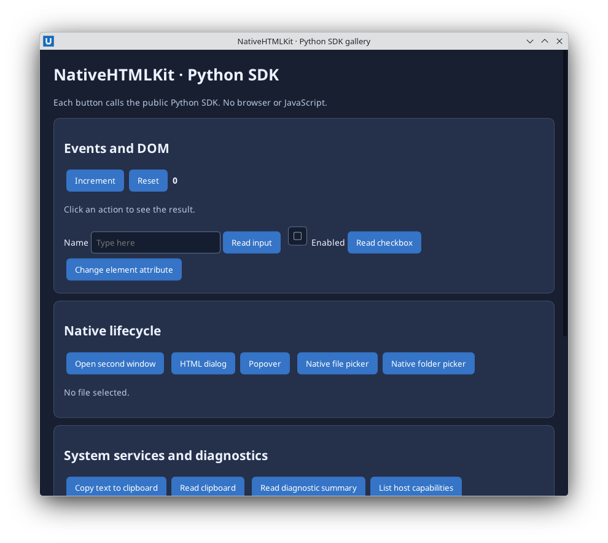

# Screenshots and media

Every screenshot on this site is a **real capture**. Each example was started unchanged with the
released packages (Core 1.0.3, Python SDK 0.1.2, PowerShell SDK 0.1.2 on PowerShell 7.7, UI 0.1.1,
CLI 0.1.2) on **KDE Plasma 6.6 Wayland** (1280×800, 100% scaling) and its window captured with KDE
Spectacle (active window only). Nothing was retouched. Windows looks the same apart from the window
frame. Every example page shows its own capture; the four capability galleries are below.

| Python SDK | Python UI |
|---|---|
|  |  |
| **PowerShell SDK** | **PowerShell UI** |
|  |  |

## Capturing a new screenshot

1. Install the **exact released** packages on the target desktop and note the OS, runtime and versions.
2. Run the example unchanged from a neutral working directory (and a scratch `HOME` if the example
   shows a file path), so no personal paths appear in the window.
3. Exercise what the page describes. Never present a capture of a broken state as working.
4. Capture only the window (KDE: `spectacle -b -n -a -o shot.png`; Windows: Win+Shift+S, window mode).
5. Save it in the owning repository under `docs/images/examples/` with that repository's naming
   (`py-sdk-<file>.png`, `ps-sdk-<file>.png`, `ui-py-<file>.png`, `ui-ps-<file>.png`) and re-run
   `scripts/import-docs.py` here.
