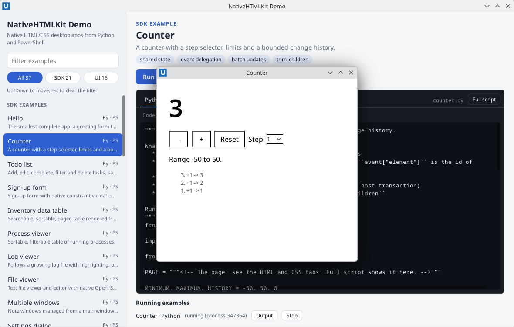
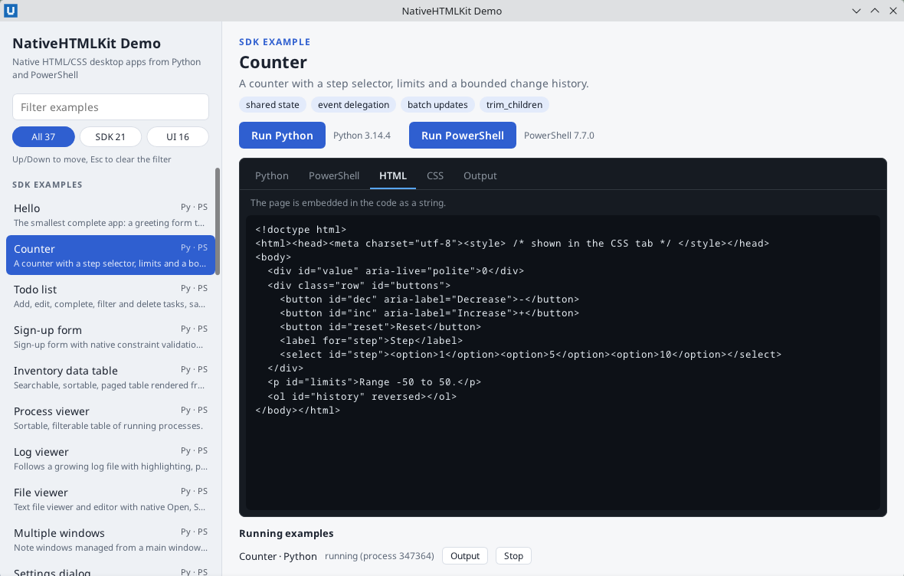
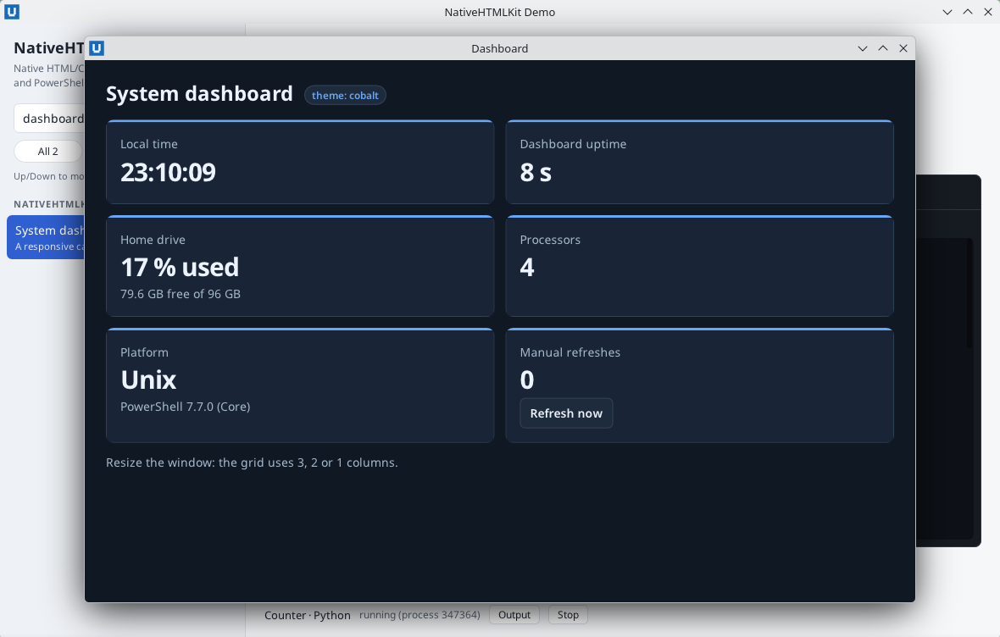

# Try the demo

The quickest way to see what NativeHTMLKit can do: install one package and get a window that lists
every example from these docs. Each example shows its Python, PowerShell, HTML and CSS source, and
starts with one click as its own native window.



*Real capture: NativeHTMLKit Demo 0.1.1, KDE Plasma 6.6 Wayland. The Counter
example was started with **Run Python** and clicked three times.*

## Install and start

=== "Python"

    ```bash
    uvx nativehtmlkit-demo                    # run it without installing
    uv tool install nativehtmlkit-demo        # or install the command, then:
    nativehtmlkit-demo
    ```

    Needs [uv](https://docs.astral.sh/uv/getting-started/installation/) (it provides Python 3.10 or later if needed). The demo comes with the
    [`nativehtmlkit`](https://pypi.org/project/nativehtmlkit/) SDK and
    [`nativehtmlkit_ui`](https://pypi.org/project/nativehtmlkit_ui/), which its Python examples use.

=== "PowerShell"

    ```powershell
    Install-Module NativeHTMLKit.Demo -Scope CurrentUser
    Start-NativeHTMLKitDemo
    ```

    Works in PowerShell 7 (Linux and Windows) and Windows PowerShell 5.1. This installs the
    [`NativeHTMLKit`](https://www.powershellgallery.com/packages/NativeHTMLKit) and
    [`NativeHTMLKit.UI`](https://www.powershellgallery.com/packages/NativeHTMLKit.UI) modules too.
    The command returns when you close the demo window.

Each package contains the same window and the same examples. To run the examples of **both**
languages, install both packages. The demo finds Python and PowerShell on your `PATH`, and when one
is missing, the button for that language says what to install.

## Using the window

1. **Pick an example** on the left; each shows a one-line summary. The *SDK examples* use your own
   HTML and CSS with events and page updates. The *NativeHTMLKit UI examples* use the reactive
   component library.
    - **All / SDK / UI** narrows the list to one kind and shows how many examples match.
    - **Filter examples** searches titles, summaries and topics; the **×** button or **Esc** clears it.
    - **Up** and **Down** move through the list, also while you type in the filter box.
2. **Read the source** in the tabs (the source panel is always dark):
    - **Python** and **PowerShell**: the code only. The page HTML and the stylesheet are replaced by a
      one-line pointer to their tabs. **Full script** shows the single file exactly as it ships.
    - **HTML** and **CSS**: the page. For SDK examples this is the page embedded in the code or loaded
      from `index.html`. For UI examples it is the HTML the library generates for the first render.
3. **Run Python** or **Run PowerShell** starts the example in a separate process, as a normal window
   of its own. Start as many as you like, including the same example in both languages side by side.
4. **Running examples** at the bottom lists what you started. **Stop** ends an example. **Output**
   opens the Output tab with everything the example printed, which shows why it stopped if it failed.

Closing the demo window also closes the examples it started.

| HTML tab of an SDK example | A UI example started with Run PowerShell |
|---|---|
|  |  |

Examples run from a working folder under your temporary directory (`nativehtmlkit-demo/<example>`).
Examples that save data, such as the todo list, save it where their own documentation says. The log
viewer gets a sample log file that keeps growing while it runs.

## Check an installation

```bash
uvx nativehtmlkit-demo --self-test
```

```powershell
Start-NativeHTMLKitDemo -SelfTest
```

The self-test runs the demo without a window. It checks every example and its source tabs, starts a
few examples in each installed language, and stops them again. It prints `PASS`, `FAIL` and `SKIP`
lines, and exits with code 0 when nothing failed. `SKIP` means a language is not installed.

## Next steps

When an example does what you need, open its page in these docs for the explanation. Each page has
the same source and a screenshot:

- [UI library examples](../ui/index.md): [Python](../ui/python/examples/index.md) · [PowerShell](../ui/powershell/examples/index.md)
- [SDK examples](../sdk/index.md): [Python](../sdk/python/examples/index.md) · [PowerShell](../sdk/powershell/examples/index.md)
- [Install and first steps](index.md): install just the library you build with.

The demo's source is at [nativehtmlkit/nativehtmlkit-demo](https://github.com/nativehtmlkit/nativehtmlkit-demo)
(packages: [PyPI `nativehtmlkit-demo`](https://pypi.org/project/nativehtmlkit-demo/) and
[Gallery `NativeHTMLKit.Demo`](https://www.powershellgallery.com/packages/NativeHTMLKit.Demo)).
