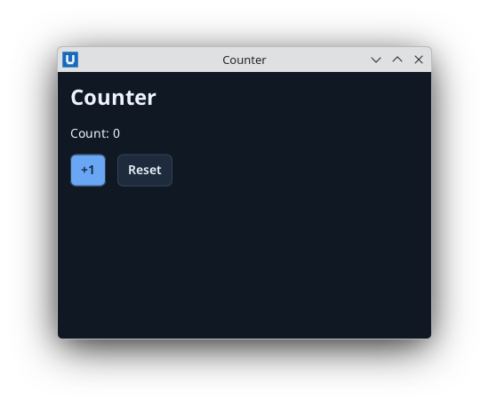

# PowerShell UI in five minutes

`NativeHTMLKit.UI` adds reactive components to PowerShell: states created with `New-NHKUiState`, components added with `Add-NHKUi*`, and the page updates whenever a bound state changes. It uses only public `NativeHTMLKit` SDK commands. UI 0.1.1 is an early release.

## 1. Install

```powershell
Install-Module NativeHTMLKit.UI -Scope CurrentUser    # installs the NativeHTMLKit SDK as a dependency
```

## 2. Write `hello-ui.ps1`

<!-- include: examples/getting-started/hello-ui.ps1 -->
```powershell title="examples/getting-started/hello-ui.ps1"
# Hello, NativeHTMLKit.UI: a reactive counter in PowerShell.
#
# Teaches: New-NHKUi, New-NHKUiState, Add-NHKUiText -Bind, Add-NHKUiButton -Data/-OnClick,
#          Start-NHKUi and Stop-NHKUi.
# Run:     pwsh -File hello-ui.ps1        (Windows PowerShell 5.1: powershell.exe -File hello-ui.ps1)
# Guide:   docs/getting-started/powershell-ui.md
$ErrorActionPreference = 'Stop'
Import-Module NativeHTMLKit.UI -ErrorAction Stop   # also loads the NativeHTMLKit SDK
$app = Start-NativeHTMLKitScript -Name 'Counter'

$count = New-NHKUiState -Value 0
$label = New-NHKUiComputed -DependsOn @($count) -Data $count -Compute { param($c) "Count: $($c.Value)" }
$ui = New-NHKUi -Title 'Counter' -Theme cobalt -Density regular -Width 420 -Height 300
$null = Add-NHKUiColumn -UI $ui -Content {
    $null = Add-NHKUiHeading -UI $ui -Text 'Counter' -Level 1
    $null = Add-NHKUiText -UI $ui -Bind $label
    $null = Add-NHKUiRow -UI $ui -Content {
        $null = Add-NHKUiButton -UI $ui -Text '+1' -Data $count -OnClick { param($eventObject, $state) $state.Set([int]$state.Value + 1) }
        $null = Add-NHKUiButton -UI $ui -Text 'Reset' -Variant secondary -Data $count -OnClick { param($eventObject, $state) $state.Set(0) }
    }
}

try {
    $null = Start-NHKUi -UI $ui -Application $app   # opens the window and announces ready
    Wait-NativeHTMLKit -Application $app -UntilShutdown
} finally {
    Stop-NHKUi -UI $ui
    $label.Dispose()
    Close-NativeHTMLKit -Application $app
}
```
<!-- /include -->

## 3. Run it

```powershell
pwsh -File hello-ui.ps1
powershell.exe -File .\hello-ui.ps1     # Windows PowerShell 5.1
```



*Real capture on KDE Plasma 6.6 Wayland with Core 1.0.3 and PowerShell SDK 0.1.2 + UI 0.1.1 on PowerShell 7.7.*

## What just happened

- `New-NHKUiState -Value 0` creates an observable value with `.Value` and `.Set(...)`.
- `New-NHKUiComputed` derives a value from states listed explicitly in `-DependsOn`; it recomputes whenever one of them changes. `-Data` is handed to the `-Compute` block.
- Button callbacks receive `($eventObject, $data)`, where `$data` is what you passed with `-Data`.
- `Start-NHKUi` opens the window and (unless `-NoReady`) announces ready; you still run `Wait-NativeHTMLKit -UntilShutdown` yourself. `Stop-NHKUi` ends the bindings; dispose computed values with `.Dispose()`.

## Next steps

- Tutorial: [a settings editor that saves JSON](../tutorials/powershell-ui-settings.md).
- Themes and densities: [Theme the UI library](../how-to/theming-ui.md).
- Exact API: [UI reference](https://github.com/nativehtmlkit/nativehtmlkit_ui/blob/main/docs/API.md).
