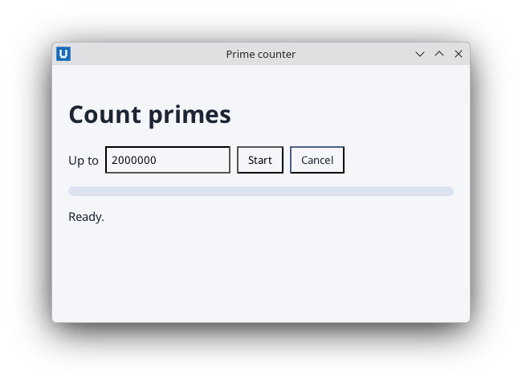

# Background work

**Goal:** run something slow (a computation, file processing, a network call of your own) without freezing the window, show progress, and allow cancelling.

## Python SDK: a worker thread

Event callbacks of one application run in order on one event worker. A slow callback delays every following event, so start a thread for the work and return. SDK calls are thread-safe: the worker may update the page directly.

<!-- include: examples/howto/python/prime_counter.py -->
```python title="examples/howto/python/prime_counter.py"
"""Prime counter: run a long computation in a worker thread with progress and a Cancel button.

Teaches: keeping event callbacks short (they share one ordered event worker), starting a
threading.Thread for slow work, updating the page from that thread (SDK calls are thread-safe),
throttling progress updates, cooperative cancellation with threading.Event, and disabling controls
while a job runs.
Run:     python prime_counter.py
Guide:   docs/how-to/background-work.md
"""
import threading
import time

from nativehtmlkit import Application

PAGE = """<!doctype html>
<html lang="en"><head><meta charset="utf-8"><style>
  body { font: 15px sans-serif; margin: 0; padding: 20px; background: #f4f6fa; color: #1d2433; }
  form { display: flex; gap: 8px; align-items: center; }
  input { width: 140px; padding: 6px; }
  button { padding: 6px 12px; }
  .track { height: 12px; background: #dde3ee; border-radius: 6px; margin: 16px 0 8px; }
  #bar { height: 12px; width: 0%; background: #2f6fd0; border-radius: 6px; }
</style></head>
<body>
  <h1>Count primes</h1>
  <form id="job">
    <label for="limit">Up to</label>
    <input id="limit" type="number" min="10" max="50000000" step="1" value="2000000" required>
    <button id="start">Start</button>
    <button id="cancel" type="button" disabled>Cancel</button>
  </form>
  <div class="track"><div id="bar"></div></div>
  <p id="status" role="status">Ready.</p>
</body></html>"""


def count_primes(limit, cancelled, progress):
    """Sieve of Eratosthenes in chunks; calls progress(fraction) now and then."""
    sieve = bytearray([1]) * (limit + 1)
    sieve[0:2] = b"\x00\x00"
    step = 0
    for n in range(2, int(limit ** 0.5) + 1):
        if cancelled.is_set():
            return None
        if sieve[n]:
            sieve[n * n::n] = bytes(len(range(n * n, limit + 1, n)))
        step += 1
        if step % 200 == 0:
            progress(n * n / limit)
    return sum(sieve)


def main():
    with Application.start(name="Prime counter") as app:
        window = app.open_html(PAGE, title="Prime counter", width=520, height=320)
        doc = window.document
        job = {"cancel": None, "running": False}

        def set_running(running):
            if running:
                doc.set_attribute("start", "disabled", "")
                doc.remove_attribute("cancel", "disabled")
            else:
                doc.remove_attribute("start", "disabled")
                doc.set_attribute("cancel", "disabled", "")

        def worker(limit, cancelled):
            started = time.monotonic()
            last = [0.0]

            def progress(fraction):
                now = time.monotonic()
                if now - last[0] > 0.1:  # at most ten page updates per second
                    last[0] = now
                    doc.set_attribute("bar", "style", f"width: {fraction * 100:.0f}%")
                    doc.set_text("status", f"Working... {fraction:.0%}")

            try:
                result = count_primes(limit, cancelled, progress)
                if result is None:
                    doc.set_text("status", "Cancelled.")
                else:
                    doc.set_attribute("bar", "style", "width: 100%")
                    doc.set_text("status", f"Done: {result:,} primes up to {limit:,} "
                                           f"in {time.monotonic() - started:.2f} s.")
                set_running(False)
            except Exception as error:  # StaleDocumentError when the window closed mid-job
                print(f"Prime job stopped: {type(error).__name__}")
            finally:
                job["running"] = False

        def start(_event):
            if job["running"]:
                return  # one job at a time
            job["running"] = True
            limit = int(doc.get_value("limit"))
            job["cancel"] = threading.Event()
            set_running(True)
            doc.set_text("status", "Starting...")
            # daemon=True: a running job never keeps the process alive after the window closed.
            threading.Thread(target=worker, args=(limit, job["cancel"]), daemon=True).start()

        def cancel(_event):
            if job["cancel"] is not None:
                job["cancel"].set()

        doc.on("submit", start, element="job")
        doc.on("click", cancel, element="cancel")
        app.run()


if __name__ == "__main__":
    main()
```
<!-- /include -->



*Real capture on KDE Plasma 6.6 Wayland with Core 1.0.3 and Python SDK 0.1.2.*

- Throttle progress updates (here at most ten per second); each update is a message to the host.
- Cancel cooperatively with a `threading.Event` that the work checks regularly.
- Make worker threads `daemon=True`, and catch the stale-document error raised when the window closes while the job runs.
- For SDK requests that may take long themselves (dialogs), use their `wait=False` form instead of a thread; see [file dialogs](file-dialogs.md). An `asyncio` adapter also exists (`app.async_adapter()`), documented in the [Python SDK reference](https://github.com/nativehtmlkit/nativehtmlkit-python/blob/main/docs/API.md).

## Python UI: set state from the worker

`State.set()` may be called from any thread; the library schedules the page update on the UI's owner thread. `ui.post(callable, *args)` runs a function on that owner thread when you need ordering with other UI work.

<!-- include: examples/howto/python-ui/word_counter.py -->
```python title="examples/howto/python-ui/word_counter.py"
"""Word counter: count words in a large text file in a worker thread and show progress with UI state.

Teaches: starting background work from a UI event, setting State from a worker thread (bindings
marshal the page update onto the UI owner thread), throttled progress, a Cancel button, and
avoiding computed() values whose dependencies change on several threads at once (a known
limitation in nativehtmlkit_ui 0.1.1).
Run:     python word_counter.py [FILE]   (without FILE it generates sample text in memory)
Guide:   docs/how-to/background-work.md
"""
import re
import sys
import threading
import time
from collections import Counter
from contextlib import nullcontext
from pathlib import Path

from nativehtmlkit import Application
from nativehtmlkit_ui import UI, state

WORD = re.compile(r"[^\W\d_]+(?:'[^\W\d_]+)?")


def sample_lines():
    words = "the quick brown fox jumps over the lazy dog while native windows render html".split()
    for i in range(200_000):
        yield " ".join(words[(i + j) % len(words)] for j in range(9))


def main():
    with Application.start(name="Word counter") as app:
        source = Path(sys.argv[1]) if len(sys.argv) > 1 else None
        progress = state("Press Count to start.")
        top_words = state([])
        running = state(False)
        cancel = threading.Event()

        def work():
            counts, lines, done, last = Counter(), 0, 0, 0.0
            try:
                opened = source.open(encoding="utf-8", errors="replace") if source else nullcontext(sample_lines())
                with opened as stream:
                    total = max(1, source.stat().st_size) if source else 200_000
                    for line in stream:
                        if cancel.is_set():
                            progress.set("Cancelled.")
                            return
                        counts.update(word.lower() for word in WORD.findall(line))
                        lines += 1
                        done += len(line.encode("utf-8")) if source else 1
                        if time.monotonic() - last > 0.2:  # at most five updates per second
                            last = time.monotonic()
                            progress.set(f"{done / total:.0%} - {lines:,} lines")
                progress.set(f"Done: {sum(counts.values()):,} words, {len(counts):,} different, {lines:,} lines.")
                top_words.set([f"{word}: {count:,}" for word, count in counts.most_common(10)])
            except OSError as error:
                progress.set(f"Cannot read the file: {error.strerror}")
            finally:
                running.set(False)

        def start(_event):
            if running.value:
                return
            cancel.clear()
            running.set(True)
            top_words.set([])
            progress.set("Starting...")
            threading.Thread(target=work, name="word-count", daemon=True).start()

        ui = UI(title="Word counter", theme="daylight", density="regular", width=560, height=520)
        with ui.column():
            ui.heading("Word counter", level=1)
            ui.text(f"Source: {source.name if source else 'generated sample text'}", muted=True)
            with ui.container("form") as form:
                with ui.row():
                    ui.element("button", css_class="nhk-button nhk-primary", attrs={"type": "submit"}, text="Count")
                    ui.button("Cancel", variant="secondary", on_click=lambda _e: cancel.set(),
                              disabled=lambda: not running.value)
            ui.on(form, "submit", start)
            ui.alert(progress)
            with ui.card():
                ui.heading("Most frequent words", level=2)
                ui.text_list(top_words)
        try:
            ui.mount(app)
            app.run()
        finally:
            cancel.set()
            ui.dispose()


if __name__ == "__main__":
    main()
```
<!-- /include -->

!!! warning "Known limitation in UI 0.1.1"
    A `computed()` value can race when several threads change its dependencies at the same time. Keep background updates to plain `state()` values, as in this example, or post them to the owner thread with `ui.post()`. See [limitations](../capabilities/limitations.md).

## PowerShell: Start-NativeHTMLKitTask

PowerShell callbacks run on your script's runspace, so a slow command in a callback blocks the window. `Start-NativeHTMLKitTask` runs a script block in an **isolated runspace** and calls `-OnCompleted` or `-OnFailed` back on your runspace, during the event pump.

<!-- include: examples/howto/powershell/file-hash.ps1 -->
```powershell title="examples/howto/powershell/file-hash.ps1"
# File hash: compute a file checksum in the background while the window stays responsive (PowerShell).
#
# Teaches: Start-NativeHTMLKitTask (an isolated runspace: pass plain data with -ArgumentList, never
#          SDK objects), -OnCompleted / -OnFailed callbacks that run on the owning runspace,
#          -TimeoutMilliseconds, Stop-NativeHTMLKitTask for Cancel, and enabling/disabling buttons.
# Run:     pwsh -File file-hash.ps1 [-Path FILE]  (Windows PowerShell 5.1: powershell.exe -File file-hash.ps1)
# Guide:   docs/how-to/background-work.md
param([string]$Path = '')
$ErrorActionPreference = 'Stop'
Import-Module NativeHTMLKit -ErrorAction Stop
$app = Start-NativeHTMLKitScript -Name 'File hash'

$page = @'
<!doctype html>
<html lang="en"><head><meta charset="utf-8"><style>
  body { font: 14px sans-serif; margin: 0; padding: 18px; background: #f4f6fa; color: #1d2433; }
  form { display: grid; grid-template-columns: auto 1fr; gap: 8px 10px; align-items: center; }
  input, select { padding: 6px; }
  .buttons { grid-column: 2; display: flex; gap: 8px; }
  button { padding: 6px 12px; }
  #hash { font: 13px monospace; word-break: break-all; background: white; padding: 8px; border-radius: 6px; min-height: 1.2em; }
</style></head>
<body>
  <h1>File hash</h1>
  <form id="job">
    <label for="path">File</label><input id="path" required placeholder="Full path of a file">
    <label for="algorithm">Algorithm</label>
    <select id="algorithm"><option>SHA256</option><option>SHA384</option><option>SHA512</option><option>MD5</option></select>
    <div class="buttons"><button id="start">Compute</button><button id="cancel" type="button" disabled>Cancel</button></div>
  </form>
  <p id="status" role="status">Ready.</p>
  <div id="hash"></div>
</body></html>
'@

# Runs in its own runspace with only the arguments it is given.
$hashJob = {
    param([string]$File, [string]$Algorithm)
    (Get-FileHash -LiteralPath $File -Algorithm $Algorithm).Hash
}

$job = [pscustomobject]@{ Task = $null; Started = $null }

function Set-Running([bool]$Running) {
    if ($Running) {
        Set-NativeHTMLKitDocumentAttribute -Document $doc -Element start -Name disabled -Value ''
        Set-NativeHTMLKitDocumentAttribute -Document $doc -Element cancel -Name disabled -Remove
    } else {
        Set-NativeHTMLKitDocumentAttribute -Document $doc -Element start -Name disabled -Remove
        Set-NativeHTMLKitDocumentAttribute -Document $doc -Element cancel -Name disabled -Value ''
    }
}

try {
    $window = New-NativeHTMLKitWindow -Application $app -Title 'File hash' -Width 620 -Height 380
    $doc = Open-NativeHTMLKitHtml -Window $window -Html $page
    if ($Path) { Set-NativeHTMLKitDocumentValue -Document $doc -Element path -Value ([IO.Path]::GetFullPath($Path)) }

    $null = Register-NativeHTMLKitDocumentEvent -Document $doc -Type submit -Element job -Callback {
        param($eventObject)
        if ($null -ne $job.Task) { return }
        $file = (Get-NativeHTMLKitValue -Document $doc -Element path).Trim()
        $algorithm = Get-NativeHTMLKitValue -Document $doc -Element algorithm
        if (-not (Test-Path -LiteralPath $file -PathType Leaf)) {
            Set-NativeHTMLKitDocumentText -Document $doc -Element status -Text 'That file does not exist.'
            return
        }
        Set-Running $true
        Set-NativeHTMLKitDocumentText -Document $doc -Element hash -Text ''
        Set-NativeHTMLKitDocumentText -Document $doc -Element status -Text "Computing $algorithm..."
        $job.Started = [Diagnostics.Stopwatch]::StartNew()
        $job.Task = Start-NativeHTMLKitTask -Application $app -ScriptBlock $hashJob -ArgumentList @($file, $algorithm) `
            -TimeoutMilliseconds 600000 -OnCompleted {
                param($result)
                $job.Task = $null
                Set-Running $false
                Set-NativeHTMLKitDocumentText -Document $doc -Element hash -Text ([string]@($result)[0])
                Set-NativeHTMLKitDocumentText -Document $doc -Element status -Text ("Done in {0:N2} s." -f $job.Started.Elapsed.TotalSeconds)
            } -OnFailed {
                param($failure)
                $job.Task = $null
                Set-Running $false
                $text = if ($failure -is [OperationCanceledException]) { 'Cancelled.' } else { 'Failed: ' + $failure.Message }
                Set-NativeHTMLKitDocumentText -Document $doc -Element status -Text $text
            }
    }
    $null = Register-NativeHTMLKitDocumentEvent -Document $doc -Type click -Element cancel -Callback {
        param($eventObject)
        if ($null -ne $job.Task) { Stop-NativeHTMLKitTask -Task $job.Task }
    }
    Set-NativeHTMLKitReady -Application $app
    Wait-NativeHTMLKit -Application $app -UntilShutdown
} finally {
    Close-NativeHTMLKit -Application $app
}
```
<!-- /include -->

- The task script block sees **only its arguments**: no variables, functions or SDK objects from your script. Passing an application, window, document or bitmap object is refused. Return plain data.
- `-TimeoutMilliseconds` and `Stop-NativeHTMLKitTask` *request* cancellation; `-OnFailed` then receives a `TimeoutException` or `OperationCanceledException`. A worker that ignores the request keeps running (and keeps its slot) until it ends.
- At most 8 tasks per application (32 per process) run at once.
- `Receive-NativeHTMLKitTask -Wait` waits for a task while still answering host messages.
- For periodic refresh, start the next task from `-OnCompleted`, as in the [dashboard tutorial](../tutorials/powershell-process-dashboard.md).

## CLI

The CLI shows one window per command and blocks until the user decides. Run other work before or after it, or start the command in the background of your shell script (`nativehtmlkit select ... &`) and `wait` for it.

More background: [Threading and callbacks](../concepts/threading.md).
