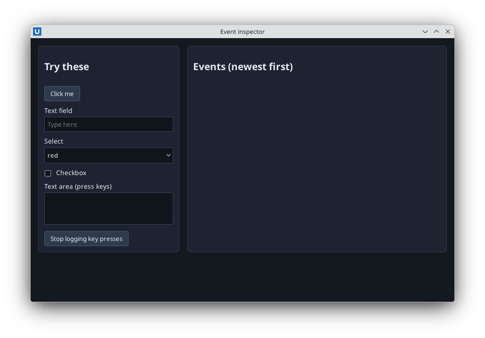

# Handle events

**Goal:** run your code when the user clicks, types, changes a selection, presses a key or submits a form.

## Subscribe to an event

Python: `document.on(event_type, callback, element="id")`. PowerShell: `Register-NativeHTMLKitDocumentEvent -Document $doc -Type <type> -Element <id> -Callback { param($eventObject) ... }`.

- With `element`, the callback runs for events whose target is that element **or anything inside it** (delegation). Without it, it runs for every event of that type in the document.
- The callback receives one event object. Useful fields: `type`, `element` (id of the nearest element with an id), `path` (ids from the target up to the document), `value` and `checked` for form controls, `key` and `code` for keyboard events, `button`, `x`, `y` for pointer events, `submitter` for `submit`.
- Notifications arrive **after** the host has handled the input natively. A callback cannot cancel a default action retroactively; register `prevent_default(element, event)` (Python) or `Set-NativeHTMLKitPreventDefault` (PowerShell) in advance instead.
- `focus` and `blur` do not bubble; for delegation use `focusin` and `focusout`. `invalid` does not bubble either: subscribe without `element` or on the control itself.
- A document accepts at most 256 subscriptions. Prefer one delegated handler on a container over one handler per row.

## Example: an event inspector

This tool logs every event the host delivers, with its fields. Keep it around for debugging your own pages.

<!-- include: examples/howto/python/event_inspector.py -->
```python title="examples/howto/python/event_inspector.py"
"""Event inspector: see exactly which events the host delivers, and with which fields.

Teaches: Document.on() for several event types, delegation with element=..., the event dictionary
(type, element, path, value, checked, key, ...), unsubscribing, and rendering a bounded log safely
with insert_html() + html.escape() and Node.trim_children().
Run:     python event_inspector.py
Guide:   docs/how-to/handle-events.md
"""
import html
import time

from nativehtmlkit import Application

PAGE = """<!doctype html>
<html lang="en"><head><meta charset="utf-8"><style>
  body { font: 14px sans-serif; margin: 0; background: #14181f; color: #e3e8f0; }
  main { display: grid; grid-template-columns: 300px 1fr; gap: 16px; padding: 16px; }
  section { background: #1d2330; border: 1px solid #2f3a4d; border-radius: 8px; padding: 12px; }
  label { display: block; margin-top: 10px; }
  input, select, textarea { width: 100%; box-sizing: border-box; margin-top: 4px; padding: 6px;
                            background: #10141b; color: #e3e8f0; border: 1px solid #3b475c; }
  input[type=checkbox] { width: auto; margin: 0 6px 0 0; padding: 0; vertical-align: middle; }
  button { margin-top: 10px; padding: 6px 12px; background: #2f3a4d; color: #e3e8f0;
           border: 1px solid #4a5870; border-radius: 4px; }
  ol { margin: 0; padding-left: 20px; font: 12px monospace; }
  li { padding: 2px 0; border-bottom: 1px solid #262e3c; }
</style></head>
<body><main>
  <section id="controls">
    <h2>Try these</h2>
    <button id="hello">Click me</button>
    <label for="name">Text field</label><input id="name" placeholder="Type here">
    <label for="color">Select</label>
    <select id="color"><option>red</option><option>green</option><option>blue</option></select>
    <label><input id="agree" type="checkbox"> Checkbox</label>
    <label for="notes">Text area (press keys)</label><textarea id="notes" rows="3"></textarea>
    <button id="pause">Stop logging key presses</button>
  </section>
  <section>
    <h2>Events (newest first)</h2>
    <ol id="log"></ol>
  </section>
</main></body></html>"""

FIELDS = ("element", "path", "value", "checked", "key", "button")


def main():
    with Application.start(name="Event inspector") as app:
        window = app.open_html(PAGE, title="Event inspector", width=900, height=560)
        doc = window.document
        log = doc.node("log")

        def record(event):
            details = ", ".join(f"{name}={event[name]!r}" for name in FIELDS if event.get(name) not in (None, "", []))
            line = f"{time.strftime('%H:%M:%S')} {event['type']}: {details}"
            doc.insert_html("log", f"<li>{html.escape(line)}</li>", position="afterbegin")
            log.trim_children(50, from_start=False)  # keep the newest 50 (the first 50 children)

        # Delegation: one subscription per type covers every control inside #controls. (focus and blur
        # do not bubble, so their bubbling twins focusin and focusout are used for delegation.)
        for kind in ("click", "input", "change", "focusin", "focusout"):
            doc.on(kind, record, element="controls")
        stop_keys = doc.on("keydown", record, element="notes")

        def pause(_event):
            stop_keys()  # the returned function unsubscribes
            doc.set_text("pause", "Key presses are no longer logged")
            doc.set_attribute("pause", "disabled", "")

        doc.on("click", pause, element="pause")
        app.run()


if __name__ == "__main__":
    main()
```
<!-- /include -->



*Real capture on KDE Plasma 6.6 Wayland with Core 1.0.3 and Python SDK 0.1.2.*

- `doc.on()` returns an unsubscribe function; `stop_keys()` removes the `keydown` handler.
- `Node.trim_children(50, from_start=False)` keeps the first 50 log entries (newest first) and removes the rest.

## Delegation pattern

One handler on a list, decide by the clicked id. Excerpt from the [notes tutorial](../tutorials/python-notes.md) (tested in full there):

```python
def list_clicked(event):
    action, _, note_id = (event.get("element") or "").partition("-")   # "done-3" or "delete-3"
    ...
doc.on("click", list_clicked, element="notes")
```

In PowerShell, register one `Register-NativeHTMLKitDocumentEvent -Element notes` callback the same way and read `$eventObject.element`.

## Where callbacks run

- **Python:** all document and window events of an application run in order on one event worker thread. Keep callbacks short; a callback that waits (for example for a native dialog with `wait=True`) delays the following events. See [Background work](background-work.md).
- **PowerShell:** callbacks run on your script's runspace, inside `Wait-NativeHTMLKit` (or inside any SDK command that waits for the host). Variables that callbacks change should be properties of a shared object; see the [dashboard tutorial](../tutorials/powershell-process-dashboard.md).
- **UI libraries:** pass `on_click=` / `-OnClick` to buttons; inputs, selects and checkboxes update their bound state for you. `ui.on(element, "submit", callback)` subscribes to other supported events on a UI element (`click`, `input`, `change`, `keydown`, `submit`, `auxclick`, `contextmenu`).
- **CLI:** there are no per-event callbacks; the command's exit status and stdout are the result.

Details: [Threading and callbacks](../concepts/threading.md).
