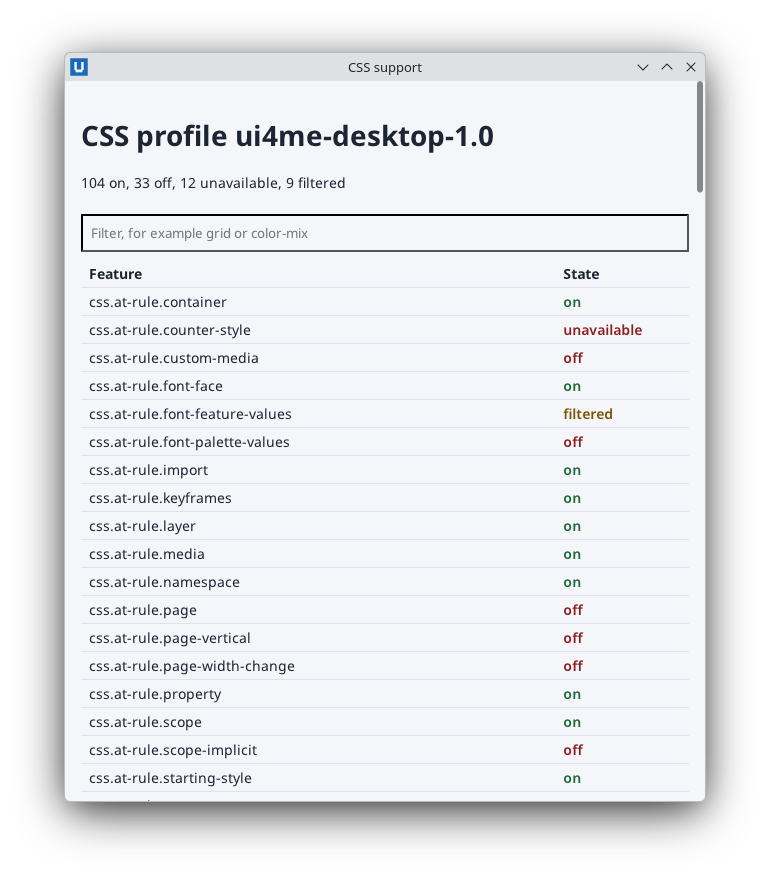

# Style with the supported CSS

**Goal:** style your pages with confidence, knowing which CSS the renderer supports, and change styles at run time.

The host renders a documented desktop CSS profile (`ui4me-desktop-1.0` in Core 1.0.3), not the whole web platform. Most everyday CSS works. The Core 1.0.3 profile reports, among others, flex and grid layout, `calc()`, `color-mix()`, `light-dark()`, `oklch()`, `@media`, `@container`, `@layer`, `@supports`, `@font-face`, `@keyframes`, `animation`, `transition`, `:has()` and `::backdrop` as on; the examples on this site also rely on custom properties (`var()`), `prefers-color-scheme` and `:invalid`, which their tests check.

## Ask the host instead of guessing

The `css_profile` document operation lists the profile's features with a state each (`on`, `off`, `filtered`, `unavailable`). Run this explorer and type a feature name:

<!-- include: examples/howto/python/css_support.py -->
```python title="examples/howto/python/css_support.py"
"""CSS support explorer: ask the running host which CSS features its renderer profile enables.

Teaches: the low-level Document.command("css_profile") operation, rendering a large table from data
with escaping, and a live "input" filter. Use it before relying on a CSS feature: the renderer
implements a documented desktop profile, not every browser feature.
Run:     python css_support.py
Guide:   docs/how-to/styling.md
"""
import html
from collections import Counter

from nativehtmlkit import Application

PAGE = """<!doctype html>
<html lang="en"><head><meta charset="utf-8"><style>
  body { font: 14px sans-serif; margin: 0; padding: 16px; background: #f4f6fa; color: #1d2433; }
  input { width: 100%; box-sizing: border-box; padding: 8px; margin: 8px 0; }
  table { border-collapse: collapse; width: 100%; }
  td, th { text-align: left; padding: 4px 8px; border-bottom: 1px solid #dde3ee; }
  td.state { font-weight: 600; }
  tr.on td.state { color: #1d6b34; }
  tr.off td.state, tr.unavailable td.state { color: #8a1f1f; }
  tr.filtered td.state { color: #7a5300; }
</style></head>
<body>
  <h1>CSS profile <span id="version"></span></h1>
  <p id="summary"></p>
  <input id="filter" type="search" placeholder="Filter, for example grid or color-mix" aria-label="Filter features">
  <table><thead><tr><th>Feature</th><th>State</th></tr></thead><tbody id="rows"></tbody></table>
</body></html>"""


def main():
    with Application.start(name="CSS support") as app:
        window = app.open_html(PAGE, title="CSS support", width=640, height=720)
        doc = window.document
        profile = doc.command("css_profile")
        features = sorted(profile["features"], key=lambda f: f["id"])
        counts = Counter(f["state"] for f in features)
        doc.set_text("version", profile.get("version", ""))
        doc.set_text("summary", ", ".join(f"{count} {state}" for state, count in counts.most_common()))

        def render(_event=None):
            needle = doc.get_value("filter").strip().lower()
            rows = [f'<tr class="{html.escape(f["state"])}"><td>{html.escape(f["id"])}</td>'
                    f'<td class="state">{html.escape(f["state"])}</td></tr>'
                    for f in features if needle in f["id"].lower()]
            doc.replace_html("rows", "".join(rows) or '<tr><td colspan="2">No matching feature</td></tr>')

        doc.on("input", render, element="filter")
        render()
        app.run()


if __name__ == "__main__":
    main()
```
<!-- /include -->



*Real capture on KDE Plasma 6.6 Wayland with Core 1.0.3 and Python SDK 0.1.2.*

In Core 1.0.3 the profile reports, for example, `@page`, `@view-transition`, `@custom-media`, `zoom`, `shape-outside`, `line-clamp` (the `-webkit-line-clamp` form is on) and `initial-letter` as off, `@counter-style` and ruby layout as unavailable, and `::part`, `::slotted` and `:host` as filtered. `doc.command("explain", element=id)` (Python) or `Invoke-NativeHTMLKitDocumentCommand -Operation explain` (PowerShell) helps when a rule does not apply as expected.

## Switch themes at run time

<!-- include: examples/howto/python/theme_switcher.py -->
```python title="examples/howto/python/theme_switcher.py"
"""Theme switcher: light/dark mode and accent colours with CSS custom properties.

Teaches: CSS custom properties (var()), @media (prefers-color-scheme) driven by the desktop or
overridden with Document.set_environment(), add_stylesheet() + replace_stylesheet() to swap one
small stylesheet at run time, and computed_style() to read back what the renderer resolved.
Run:     python theme_switcher.py
Guide:   docs/how-to/styling.md
"""
from nativehtmlkit import Application

PAGE = """<!doctype html>
<html lang="en"><head><meta charset="utf-8"><style>
  :root { --bg: #f5f7fb; --panel: #ffffff; --text: #1b2230; --muted: #5d6879; --accent: #2f6fd0; }
  @media (prefers-color-scheme: dark) {
    :root { --bg: #10151e; --panel: #19212e; --text: #e4e9f1; --muted: #9aa7ba; }
  }
  body { margin: 0; padding: 20px; font: 15px sans-serif; background: var(--bg); color: var(--text); }
  .panel { background: var(--panel); border-radius: 10px; padding: 16px; border: 1px solid color-mix(in srgb, var(--text) 15%, transparent); }
  .muted { color: var(--muted); }
  .accent { color: var(--accent); font-weight: 600; }
  button.primary { background: var(--accent); color: white; border: 0; border-radius: 6px; padding: 8px 14px; }
  form { display: grid; grid-template-columns: auto 1fr; gap: 8px 12px; align-items: center; margin-top: 12px; }
</style></head>
<body>
  <div class="panel" id="panel">
    <h1>Appearance</h1>
    <p class="muted">The page uses CSS variables; switching a theme changes a few of them.</p>
    <form id="appearance">
      <label for="scheme">Colour scheme</label>
      <select id="scheme"><option value="system">Follow the desktop</option><option value="light">Light</option><option value="dark">Dark</option></select>
      <label for="accent">Accent</label>
      <select id="accent"><option value="#2f6fd0">Blue</option><option value="#1f8a4c">Green</option><option value="#b4451f">Orange</option></select>
      <span></span><button class="primary" id="apply">Apply</button>
    </form>
    <p>Resolved accent: <span class="accent" id="resolved"></span></p>
  </div>
</body></html>"""


def main():
    with Application.start(name="Theme switcher") as app:
        window = app.open_html(PAGE, title="Theme switcher", width=520, height=420)
        doc = window.document
        # A separate, replaceable stylesheet for the run-time accent colour.
        accent_sheet = doc.add_stylesheet(":root { --accent: #2f6fd0; }")["sheet"]

        def show_resolved():
            style = doc.computed_style(["color"], "resolved")
            doc.set_text("resolved", style["properties"]["color"]["value"])

        def apply(_event):
            # "light"/"dark" override the desktop preference for this document; "system" follows it again.
            doc.set_environment(color_scheme=doc.get_value("scheme"))
            accent = doc.get_value("accent")
            if accent.startswith("#") and len(accent) == 7:  # only values from our own <select>
                doc.replace_stylesheet(accent_sheet, f":root {{ --accent: {accent}; }}")
            show_resolved()

        doc.on("submit", apply, element="appearance")
        show_resolved()
        app.run()


if __name__ == "__main__":
    main()
```
<!-- /include -->

- Define colours as custom properties on `:root`, and override them for `@media (prefers-color-scheme: dark)`.
- `set_environment(color_scheme="light" | "dark" | "system")` overrides the desktop preference for one document (`reduced_motion="reduce" | "no-preference" | "system"` works the same way). PowerShell: `Set-NativeHTMLKitEnvironment`.
- `add_stylesheet(css)` returns a sheet handle; `replace_stylesheet(sheet, css)` swaps its rules; `remove_stylesheet(sheet)` drops it. PowerShell: `Add-NativeHTMLKitStylesheet`, `Set-NativeHTMLKitStylesheet [-Remove]`.
- `computed_style([properties], element)` reports the resolved values and whether each property is supported.

## Files, fonts and images

- `window.load_file(path)` / `Open-NativeHTMLKitFile` loads an HTML file; relative stylesheet, image and font URLs resolve against its folder. For HTML strings, pass `asset_root=` / `-AssetRoot` to name that folder.
- Remote (network) URLs are never loaded; ship assets with your app, or register in-memory resources with `register_resources()` / `Register-NativeHTMLKitResources` and reference them as `ui4me-res://` URLs.
- The host ships the Noto Sans font (see its licence files), so text renders even when you bring no fonts.

## Other entry points

- **UI libraries:** add CSS with `UI(extra_css=...)` / `New-NHKUi -ExtraCss`; see [Theme the UI library](theming-ui.md).
- **CLI:** `--css FILE` adds a trusted stylesheet to `select`, `view` and `form` windows.
