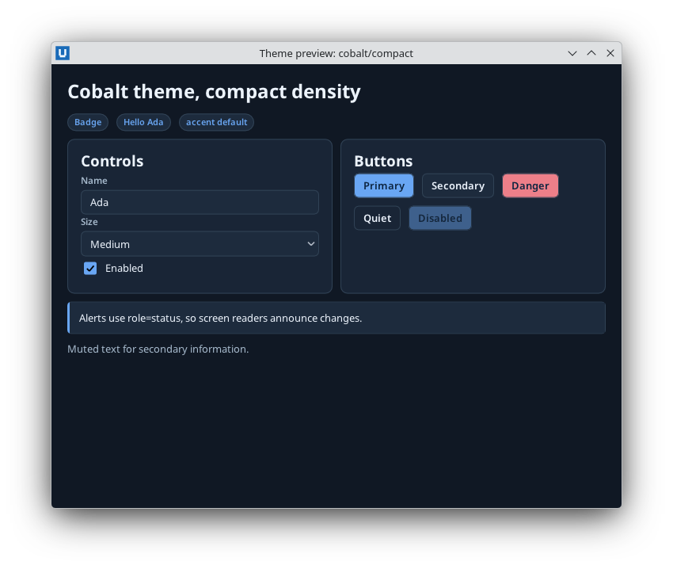

# Theme the UI library

**Goal:** choose a look for a `nativehtmlkit_ui` / `NativeHTMLKit.UI` window and adjust it to your brand.

| Setting | Python | PowerShell | Values |
|---|---|---|---|
| Theme | `UI(theme=...)` | `New-NHKUi -Theme` | `cobalt` (dark, default), `graphite` (dark), `daylight` (light) |
| Density | `UI(density=...)` | `New-NHKUi -Density` | `compact` (default), `regular`, `comfortable` |
| Extra CSS | `UI(extra_css=...)` | `New-NHKUi -ExtraCss` | appended after the library stylesheet |

Theme and density are fixed when the UI is built. To let users change them, store their choice and apply it on the next start, as the [settings tutorial](../tutorials/powershell-ui-settings.md) does.

## Override the design tokens

Each theme is a set of CSS custom properties on `body.nhk-theme-<name>`: `--nhk-bg`, `--nhk-panel`, `--nhk-panel-2`, `--nhk-border`, `--nhk-text`, `--nhk-muted`, `--nhk-accent`, `--nhk-accent-strong`, `--nhk-accent-text`, `--nhk-danger`, `--nhk-focus`, `--nhk-radius`. Densities set `--nhk-control-h`, `--nhk-font`, `--nhk-gap` and `--nhk-pad` on `body.nhk-density-<name>`. Because `extra_css` comes after the library stylesheet, a rule with the same selector wins.

<!-- include: examples/howto/python-ui/theme_preview.py -->
```python title="examples/howto/python-ui/theme_preview.py"
"""Theme preview: try the UI library's themes, densities and a custom accent colour.

Teaches: UI(theme=..., density=..., extra_css=...), overriding the library's CSS custom properties
(--nhk-accent and friends) for one theme, and the main components side by side.
Run:     python theme_preview.py [cobalt|graphite|daylight] [compact|regular|comfortable] [#RRGGBB]
Guide:   docs/how-to/theming-ui.md
"""
import re
import sys

from nativehtmlkit import Application
from nativehtmlkit_ui import UI, state

THEMES = ("cobalt", "graphite", "daylight")
DENSITIES = ("compact", "regular", "comfortable")


def main():
    with Application.start(name="Theme preview", instance="multiple") as app:
        args = sys.argv[1:]
        theme = args[0] if len(args) > 0 and args[0] in THEMES else "cobalt"
        density = args[1] if len(args) > 1 and args[1] in DENSITIES else "compact"
        accent = args[2] if len(args) > 2 and re.fullmatch(r"#[0-9A-Fa-f]{6}", args[2]) else None
        # extra_css is appended after the library stylesheet, so the same selector wins.
        extra = (f"body.nhk-theme-{theme} {{ --nhk-accent: {accent}; --nhk-accent-strong: {accent}; "
                 f"--nhk-focus: {accent}; }}") if accent else ""

        name = state("Ada")
        enabled = state(True)
        size = state("m")
        ui = UI(title=f"Theme preview: {theme}/{density}", theme=theme, density=density, extra_css=extra,
                width=720, height=560)
        with ui.column():
            ui.heading(f"{theme.title()} theme, {density} density", level=1)
            with ui.row():
                ui.badge("Badge")
                ui.badge(lambda: f"Hello {name.value}")
                ui.badge(f"accent {accent or 'default'}")
            with ui.grid():
                with ui.card():
                    ui.heading("Controls", level=2)
                    ui.input(name, label="Name")
                    ui.select(size, [("s", "Small"), ("m", "Medium"), ("l", "Large")], label="Size")
                    ui.checkbox(enabled, label="Enabled")
                with ui.card():
                    ui.heading("Buttons", level=2)
                    with ui.row():
                        ui.button("Primary")
                        ui.button("Secondary", variant="secondary")
                        ui.button("Danger", variant="danger")
                        ui.button("Quiet", variant="quiet")
                        ui.button("Disabled", disabled=True)
            ui.alert("Alerts use role=status, so screen readers announce changes.")
            ui.text("Muted text for secondary information.", muted=True)
        try:
            ui.mount(app)
            app.run()
        finally:
            ui.dispose()


if __name__ == "__main__":
    main()
```
<!-- /include -->



*Real capture on KDE Plasma 6.6 Wayland with Core 1.0.3 and Python SDK 0.1.2 + UI 0.1.1.*

```bash
python theme_preview.py daylight comfortable "#8a2be2"
```

## Tips

- Change tokens rather than restyling component classes; the token names are part of the 0.1 stylesheet and fewer rules break when the library changes.
- Check contrast when you change `--nhk-accent`: `--nhk-accent-text` is the text colour on accent backgrounds (primary buttons).
- Component markup is generated by the library; do not rely on generated element ids.
