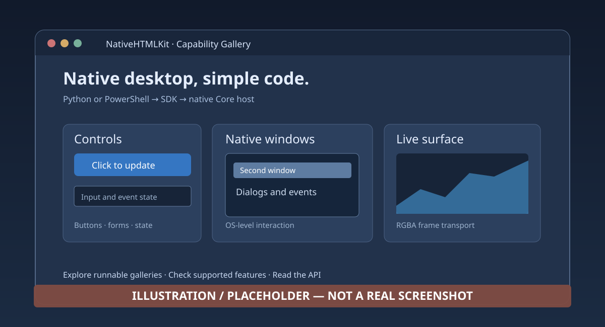

# NativeHTMLKit developer documentation

*Illustration only. For real screenshots run the demo gallery in a native desktop and capture them.*

Build native HTML/CSS desktop interfaces with familiar Python or PowerShell code. There is no browser engine or embedded JS runtime; a Rust host draws the controls and reports events over local authenticated IPC.

## Start by choosing your path

- [Python SDK](getting-started/python.md) — directly manipulate windows and documents.
- [Python UI](getting-started/python-ui.md) — use reactive state and compact components.
- [PowerShell SDK](getting-started/powershell.md) — manage windows and document events from scripts.
- [PowerShell UI](getting-started/powershell-ui.md) — reactive PowerShell components.
- [CLI](tutorials/cli-selection.md) — native selection, view and form in pipelines.

## Learn by example

The [demo gallery](https://github.com/nativehtmlkit/nativehtmlkit/blob/main/examples/README.md) has runnable source files for four entrypoints. Follow the [capture guide](demos/screenshots.md) for screenshots and short clips. Use [capability matrices](capabilities/matrix.md) to check what is exposed and in which release.

## Go deeper

[Architecture](concepts/architecture.md) · [Why this is native](concepts/why-native.md) · [Limitations](capabilities/limitations.md) · [Agent skills](https://github.com/nativehtmlkit/nativehtmlkit/blob/main/skills/README.md) · [Repository API references](reference/index.md)
