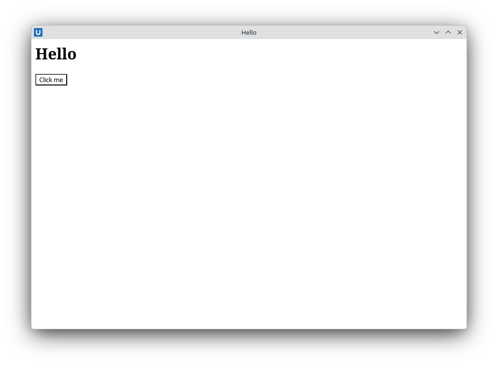
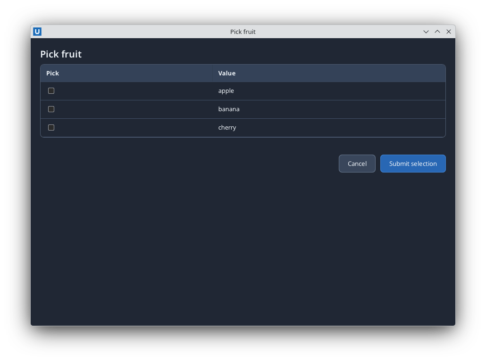
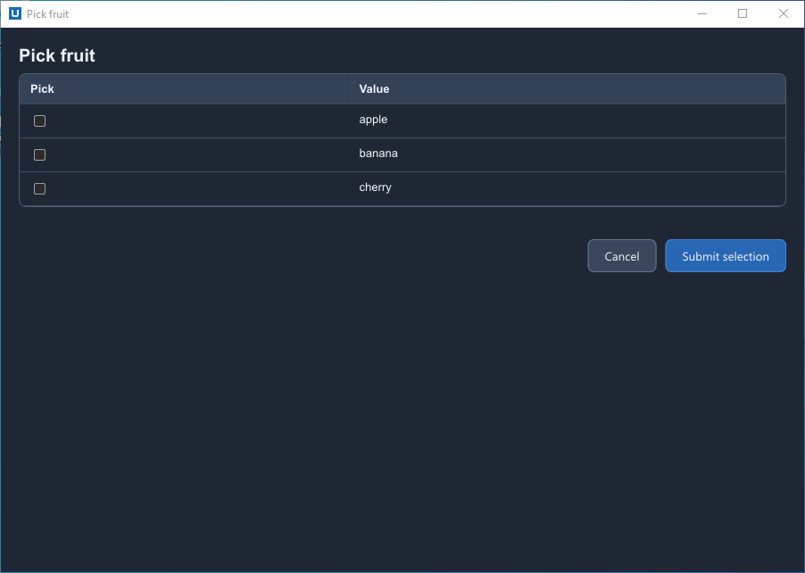

# NativeHTMLKit

**Native desktop windows from HTML and CSS, driven by a shell script, Python or PowerShell.** No browser engine, no JavaScript, no local web server: a small Rust host renders your page and sends your program the user's events over a private local connection.

## Choose what you build with

<div class="grid cards" markdown>

-   **[UI library](ui/index.md)**

    The quickest way to an app: reactive state and ready-made components (layouts, buttons, inputs,
    lists, themes). Write a few lines of Python or PowerShell, not HTML.

    [Python](ui/python/index.md) · [PowerShell](ui/powershell/index.md)

-   **[SDK](sdk/index.md)**

    Full control: your own HTML and CSS, events, page updates, native dialogs, clipboard, live
    bitmaps. The UI library is built on it.

    [Python](sdk/python/index.md) · [PowerShell](sdk/powershell/index.md)

-   **[Command line (CLI)](cli/index.md)**

    One executable for shell scripts: pick rows, view text or fill in a form in a native window and
    get the answer on stdout. Every command and option with examples.

    [Linux](cli/linux/index.md) · [Windows](cli/windows/index.md) · [Reference](cli/reference/index.md)

</div>

The UI library and the SDK work the same on Linux and Windows (the few differences are on [Linux and Windows](getting-started/platforms.md)); each has a Python and a PowerShell section with the same shape: **getting started**, step-by-step **tutorials**, task **guides**, complete **examples** with screenshots and source, and the full **API reference**. Python and PowerShell mirror each other one to one. The CLI has separate Linux and Windows sections because shell scripts differ per system.

Not sure which to pick? [Choose an entry point](getting-started/choose.md) · [Platform requirements](getting-started/requirements.md)

## What it looks like


*Real capture: the Python UI gallery on KDE Plasma 6.6 Wayland (Core 1.0.3, Python SDK 0.1.2, UI 0.1.1).*

## A complete app in a few lines

=== "UI · Python"

    ```python
    from nativehtmlkit import Application
    from nativehtmlkit_ui import UI, computed, state


    def main():
        with Application.start(name="Hello UI") as app:
            name = state("world")
            greeting = computed(lambda: f"Hello, {name.value}!")

            ui = UI(title="Hello UI", width=480, height=320)
            with ui.column():
                ui.heading(greeting, level=1)
                with ui.row():
                    ui.input(name, label="Your name")
                    ui.button("Reset", variant="secondary", on_click=lambda _event: name.set("world"))
            try:
                ui.mount(app)
                app.run()
            finally:
                ui.dispose()


    if __name__ == "__main__":
        main()
    ```

    

=== "UI · PowerShell"

    ```powershell
    $ErrorActionPreference = 'Stop'
    Import-Module NativeHTMLKit.UI
    $app = Start-NativeHTMLKitScript -Name 'Hello UI'

    $name = New-NHKUiState -Value 'world'
    $greeting = New-NHKUiComputed -DependsOn @($name) -Data $name -Compute { param($n) "Hello, $($n.Value)!" }

    $ui = New-NHKUi -Title 'Hello UI' -Width 480 -Height 320
    $null = Add-NHKUiColumn -UI $ui -Content {
        $null = Add-NHKUiHeading -UI $ui -Bind $greeting -Level 1
        $null = Add-NHKUiRow -UI $ui -Content {
            $null = Add-NHKUiInput -UI $ui -Bind $name -Label 'Your name'
            $null = Add-NHKUiButton -UI $ui -Text 'Reset' -Variant secondary -Data $name -OnClick {
                param($eventObject, $n)
                $n.Set('world')
            }
        }
    }

    try {
        $null = Start-NHKUi -UI $ui -Application $app
        Wait-NativeHTMLKit -Application $app -UntilShutdown
    } finally {
        Stop-NHKUi -UI $ui
        $greeting.Dispose()
        Close-NativeHTMLKit -Application $app
    }
    ```

    

=== "SDK · Python"

    ```python
    from nativehtmlkit import Application

    with Application.start(name="Hello") as app:
        window = app.open_html('<h1 id="title">Hello</h1><button id="go">Click me</button>')
        window.document.on("click", lambda e: window.document.set_text("title", "Clicked!"), element="go")
        app.run()
    ```

    

=== "SDK · PowerShell"

    ```powershell
    Import-Module NativeHTMLKit
    $app = Start-NativeHTMLKitScript -Name 'Hello'
    try {
        $window = New-NativeHTMLKitWindow -Application $app -Title 'Hello'
        $doc = Open-NativeHTMLKitHtml -Window $window -Html '<h1 id="title">Hello</h1><button id="go">Click me</button>'
        $null = Register-NativeHTMLKitDocumentEvent -Document $doc -Type click -Element go -Callback {
            Set-NativeHTMLKitDocumentText -Document $doc -Element title -Text 'Clicked!'
        }
        Set-NativeHTMLKitReady -Application $app
        Wait-NativeHTMLKit -Application $app -UntilShutdown
    } finally { Close-NativeHTMLKit -Application $app }
    ```

    

=== "CLI · Linux"

    ```bash
    printf '%s\n' apple banana cherry | nativehtmlkit select --multi --title "Pick fruit"
    ```

    

=== "CLI · Windows"

    ```powershell
    'apple', 'banana', 'cherry' | nativehtmlkit select --multi --title 'Pick fruit'
    ```

    

The UI tabs are the [Hello UI example](ui/python/examples/hello.md) ([PowerShell](ui/powershell/examples/hello.md)). Screenshots are real captures with the released packages: KDE Plasma 6.6 Wayland, and Windows Server 2022 for the CLI Windows tab.

## Packages

| Entry point | Package | For |
|---|---|---|
| CLI | [`nativehtmlkit` / `nhk`](https://github.com/nativehtmlkit/nativehtmlkit-cli/releases) 0.1.2 | Select rows, view text or fill a form from any shell |
| Python SDK | [`nativehtmlkit`](https://pypi.org/project/nativehtmlkit/) 0.1.2 | Windows, documents, events, dialogs, clipboard and live bitmaps |
| Python UI | [`nativehtmlkit_ui`](https://pypi.org/project/nativehtmlkit_ui/) 0.1.1 | Reactive state and compact components on the Python SDK |
| PowerShell SDK | [`NativeHTMLKit`](https://www.powershellgallery.com/packages/NativeHTMLKit) 0.1.2 | The same features as cmdlets, plus background tasks |
| PowerShell UI | [`NativeHTMLKit.UI`](https://www.powershellgallery.com/packages/NativeHTMLKit.UI) 0.1.1 | Reactive components on the PowerShell SDK |

All of them bundle the native host, Core 1.0.3 (wire protocol v1, stable). Target desktops are KDE Plasma on Wayland (Linux) and Windows; see the [capability matrix](capabilities/matrix.md) and [limitations](capabilities/limitations.md). Every example on this site is run against the released packages before it is published.

## What it is not

NativeHTMLKit is not a web browser, not a web UI framework and not a plugin platform. It runs no JavaScript, loads nothing from the network, and implements a documented [HTML and CSS profile](reference/core/html-css-support.md) rather than the whole web platform. See [Why native?](concepts/why-native.md) and [Concepts](concepts/index.md).
