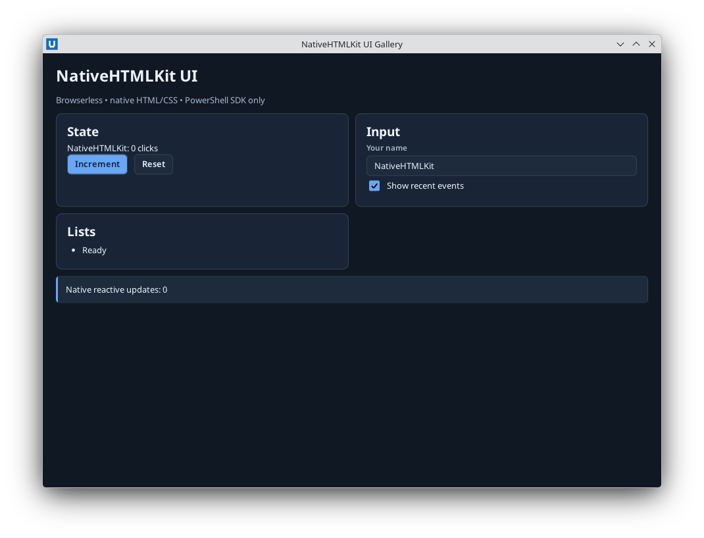

<!-- GENERATED by scripts/import-docs.py; edit the generator or the owning repository. -->
# Counter gallery

The smallest tour of state, computed text, buttons, an input, a checkbox and a list.

*Same example in Python: [Counter gallery](../../../python/ui/examples/counter.md)*



*Real capture on KDE Plasma 6.6 Wayland with the released packages.*

**What it teaches:** state and computed values; bound text; two-way input and checkbox; when regions; grid.

## Run it

```powershell
pwsh -File ./counter.ps1
```

Related guide: [reactive state](../guides/reactive-state.md)

## Source: `powershell/counter.ps1`

[View on GitHub](https://github.com/nativehtmlkit/nativehtmlkit_ui/blob/main/examples/powershell/counter.ps1)

```powershell
# Counter gallery: the smallest tour of states, computed text, buttons, input, checkbox and list.
#
# Teaches: New-NHKUiState and New-NHKUiComputed (explicit -DependsOn), passing states to a
# button callback with -Data, a two-way input and checkbox, a text list shown or hidden with
# Add-NHKUiWhen, a responsive card grid, and disposing computed states at the end.
#
# Run:  pwsh -File ./counter.ps1                      (PowerShell 7.2+, Linux or Windows)
#       powershell.exe -NoProfile -File .\counter.ps1  (Windows PowerShell 5.1)
# Needs: Install-Module NativeHTMLKit.UI -Scope CurrentUser (installs the NativeHTMLKit SDK too)
Import-Module NativeHTMLKit.UI -ErrorAction Stop
$app = Start-NativeHTMLKitScript -Name 'NativeHTMLKit UI'
$ui = New-NHKUi -Title 'NativeHTMLKit UI Gallery' -Theme cobalt -Density compact
$count = New-NHKUiState -Value 0
$name = New-NHKUiState -Value 'NativeHTMLKit'
$show = New-NHKUiState -Value $true
$history = New-NHKUiState -Value @('Ready')
$message = New-NHKUiComputed -DependsOn @($count, $name) -Data @{ Count = $count; Name = $name } -Compute {
    param($s)
    return "$($s.Name.Value): $($s.Count.Value) clicks"
}
$updates = New-NHKUiComputed -DependsOn @($count) -Data $count -Compute { param($c) "Native reactive updates: $($c.Value)" }
$null = Add-NHKUiColumn -UI $ui -Content {
    $null = Add-NHKUiHeading -UI $ui -Text 'NativeHTMLKit UI' -Level 1
    $null = Add-NHKUiText -UI $ui -Text "Browserless $([char]0x2022) native HTML/CSS $([char]0x2022) PowerShell SDK only" -Muted   # ASCII source for Windows PowerShell 5.1
    $null = Add-NHKUiGrid -UI $ui -Content {
        $null = Add-NHKUiCard -UI $ui -Content {
            $null = Add-NHKUiHeading -UI $ui -Text 'State'
            $null = Add-NHKUiText -UI $ui -Bind $message
            $null = Add-NHKUiRow -UI $ui -Content {
                $null = Add-NHKUiButton -UI $ui -Text 'Increment' -Data @{ Count = $count; History = $history } -OnClick {
                    param($eventObject, $data)
                    $data.Count.Set([int]$data.Count.Value + 1)
                    $data.History.Set(@(@("Count became $($data.Count.Value)") + @($data.History.Value) | Select-Object -First 10))
                }
                $null = Add-NHKUiButton -UI $ui -Text 'Reset' -Variant secondary -Data $count -OnClick {
                    param($eventObject, $c)
                    $c.Set(0)
                }
            }
        }
        $null = Add-NHKUiCard -UI $ui -Content {
            $null = Add-NHKUiHeading -UI $ui -Text 'Input'
            $null = Add-NHKUiInput -UI $ui -Bind $name -Label 'Your name' -Placeholder 'Enter a name'
            $null = Add-NHKUiCheckbox -UI $ui -Bind $show -Label 'Show recent events'
        }
        $null = Add-NHKUiCard -UI $ui -Content {
            $null = Add-NHKUiHeading -UI $ui -Text 'Lists'
            $null = Add-NHKUiWhen -UI $ui -Bind $show -Content {
                $null = Add-NHKUiTextList -UI $ui -Bind $history
            }
        }
    }
    $null = Add-NHKUiAlert -UI $ui -Bind $updates
}
try {
    $null = Start-NHKUi -UI $ui -Application $app
    Wait-NativeHTMLKit -Application $app -UntilShutdown
} finally {
    Stop-NHKUi -UI $ui
    $message.Dispose()
    $updates.Dispose()
    Close-NativeHTMLKit -Application $app
}
```
