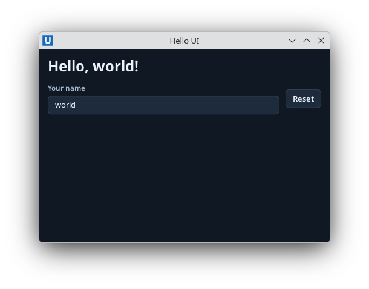

<!-- GENERATED by scripts/import-docs.py; edit the generator or the owning repository. -->
# Hello UI

The first window: a greeting that follows a text field, and a Reset button.

*Same example in Python: [Hello UI](../../../python/ui/examples/hello.md)*



*Real capture on KDE Plasma 6.6 Wayland with the released packages.*

**What it teaches:** state and computed values; two-way input; button handler; application lifecycle.

## Run it

```powershell
pwsh -File ./hello.ps1
```

Related guide: [reactive state](../guides/reactive-state.md)

## Source: `powershell/hello.ps1`

[View on GitHub](https://github.com/nativehtmlkit/nativehtmlkit_ui/blob/main/examples/powershell/hello.ps1)

```powershell
# Hello UI: the first window of the getting-started page.
#
# Teaches: Start-NativeHTMLKitScript, New-NHKUiState and New-NHKUiComputed, a heading bound to a
#          computed state, a two-way input, a button callback that sets state, Start-NHKUi /
#          Wait-NativeHTMLKit / Stop-NHKUi in try/finally.
# Run:     pwsh -File ./hello.ps1   |   powershell.exe -NoProfile -File .\hello.ps1
#          (Install-Module NativeHTMLKit.UI -Scope CurrentUser)
# Guide:   docs/powershell/getting-started.md
$ErrorActionPreference = 'Stop'
Import-Module NativeHTMLKit.UI
$app = Start-NativeHTMLKitScript -Name 'Hello UI'

$name = New-NHKUiState -Value 'world'
$greeting = New-NHKUiComputed -DependsOn @($name) -Data $name -Compute { param($n) "Hello, $($n.Value)!" }

$ui = New-NHKUi -Title 'Hello UI' -Width 480 -Height 320
$null = Add-NHKUiColumn -UI $ui -Content {
    $null = Add-NHKUiHeading -UI $ui -Bind $greeting -Level 1
    $null = Add-NHKUiRow -UI $ui -Content {
        $null = Add-NHKUiInput -UI $ui -Bind $name -Label 'Your name'
        $null = Add-NHKUiButton -UI $ui -Text 'Reset' -Variant secondary -Data $name -OnClick {
            param($eventObject, $n)
            $n.Set('world')
        }
    }
}

try {
    $null = Start-NHKUi -UI $ui -Application $app
    Wait-NativeHTMLKit -Application $app -UntilShutdown
} finally {
    Stop-NHKUi -UI $ui
    $greeting.Dispose()
    Close-NativeHTMLKit -Application $app
}
```
