<!-- GENERATED by scripts/import-docs.py; edit the generator or the owning repository. -->
# PowerShell examples

Every example is a complete program, verified against the real NativeHTMLKit host. Open one to see a screenshot, how to run it and its full source.

| Example | What it does | |
|---|---|---|
| [Hello UI](hello.md) | The first window: a greeting that follows a text field, and a Reset button. | 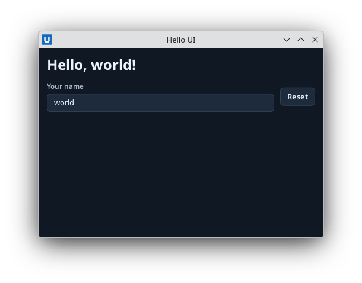 |
| [Counter gallery](counter.md) | The smallest tour of state, computed text, buttons, an input, a checkbox and a list. | 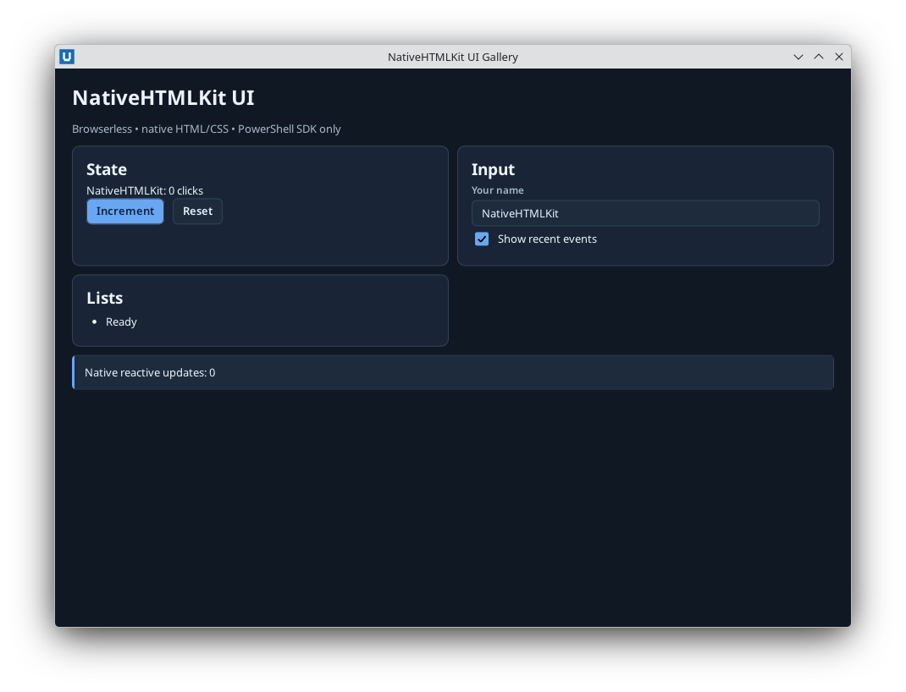 |
| [Expense tracker](expenses.md) | Add expenses, remove the last one, filter by category and see totals (expense-tracker tutorial app). | 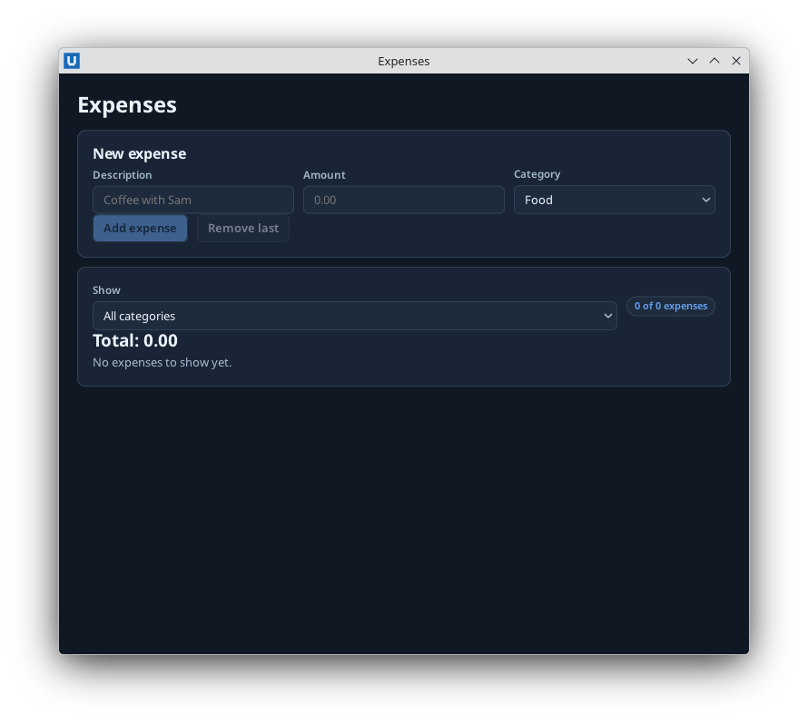 |
| [Task list](todo.md) | Tasks with Done/Remove buttons per row and an All/Open/Done filter. | 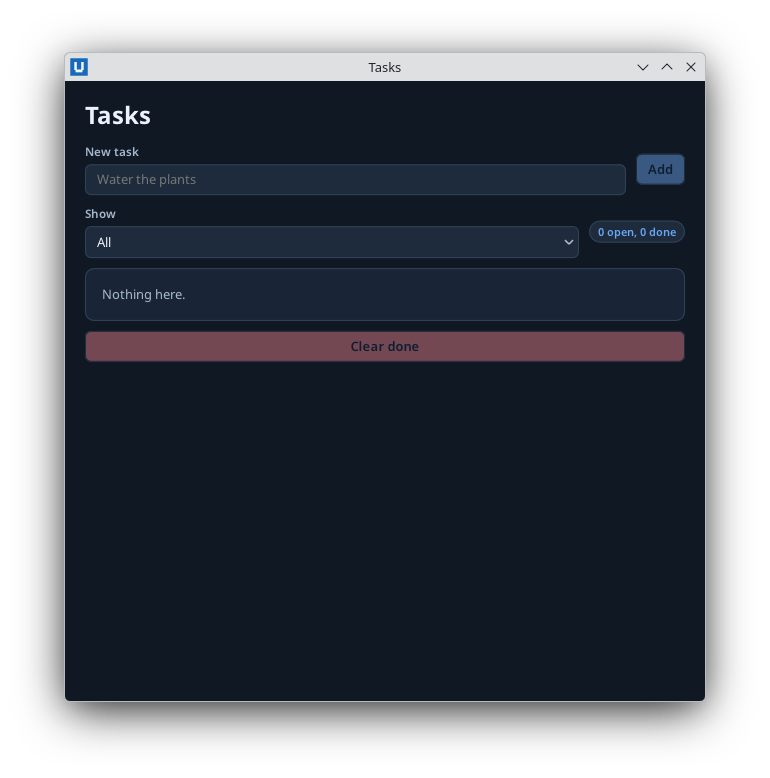 |
| [Sign-up form](signup-form.md) | Live validation, a guarded submit button, a confirmation screen and reset. | 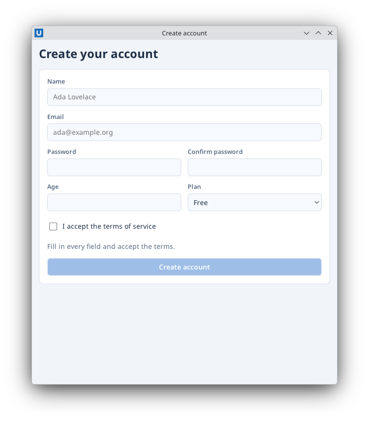 |
| [Settings panel](settings.md) | Save, Revert and Restore defaults with an unsaved-changes indicator. | 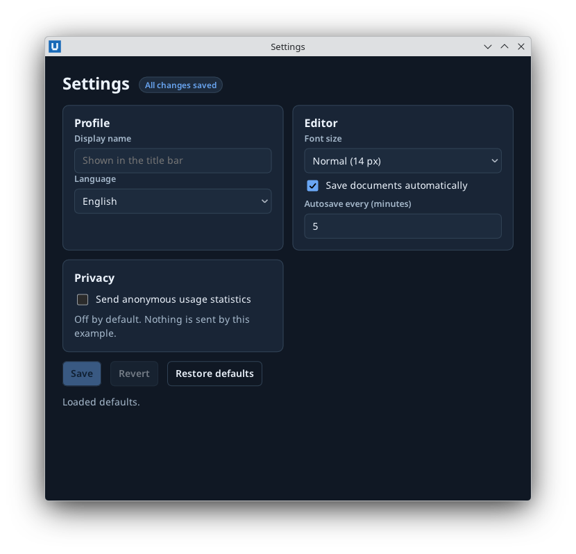 |
| [Settings editor](settings-editor.md) | Edit, validate and save a JSON settings file; the saved theme applies on the next start (settings-editor tutorial app). | 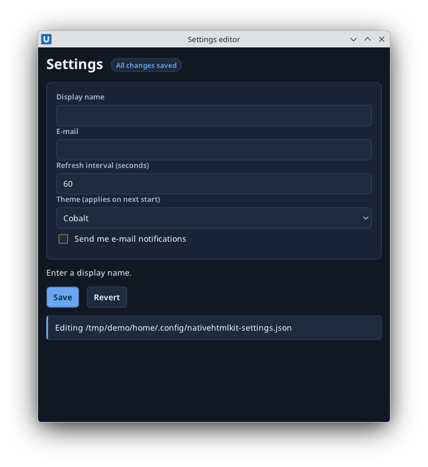 |
| [Live log viewer](log-viewer.md) | A background producer streams log lines; filter by level and text, pause and clear. | 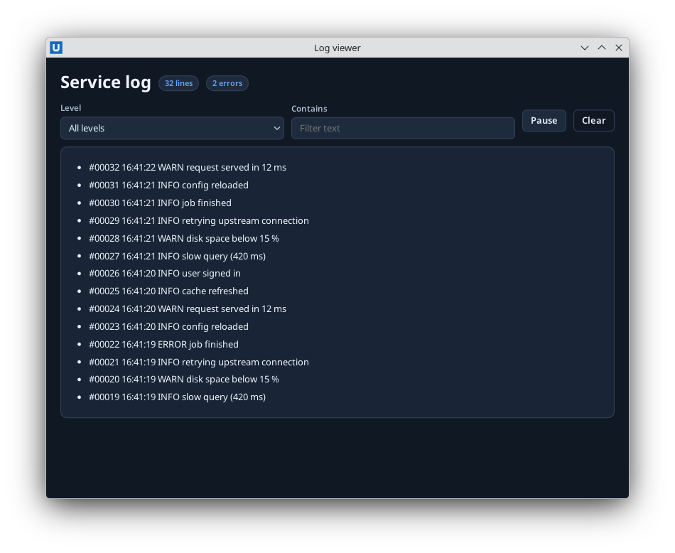 |
| [Background calculation](background.md) | Run a slow calculation off the UI thread and report the result; cancel it. | 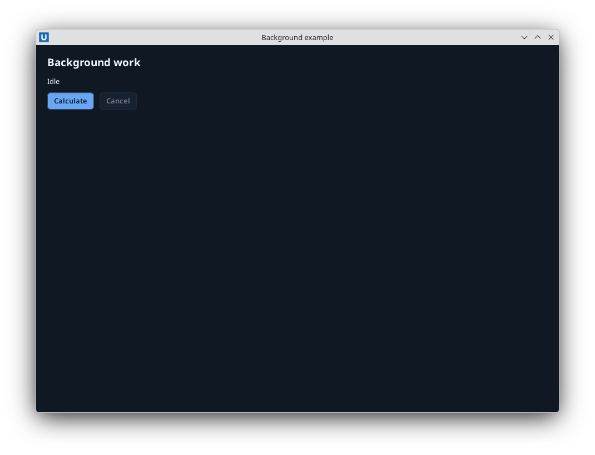 |
| [Word counter](word-counter.md) | Count words in a text file in the background with progress, Cancel and a top-ten list. | 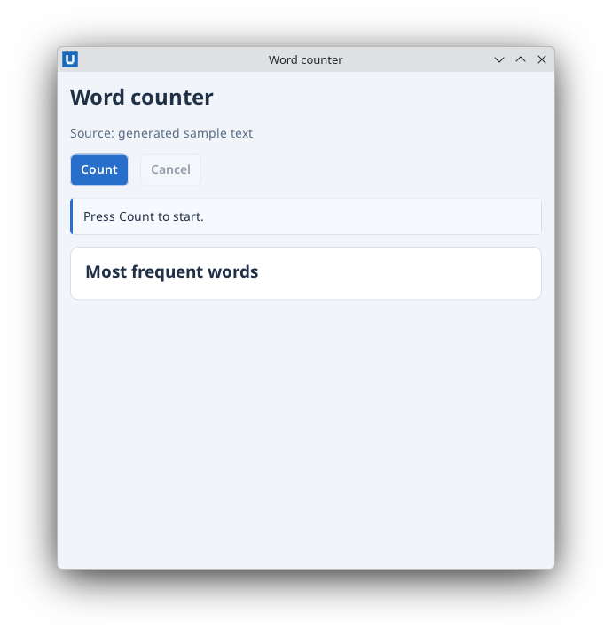 |
| [Clipboard text tool](clipboard-tool.md) | Transform text and copy or paste it with the SDK clipboard, handling unavailability. | 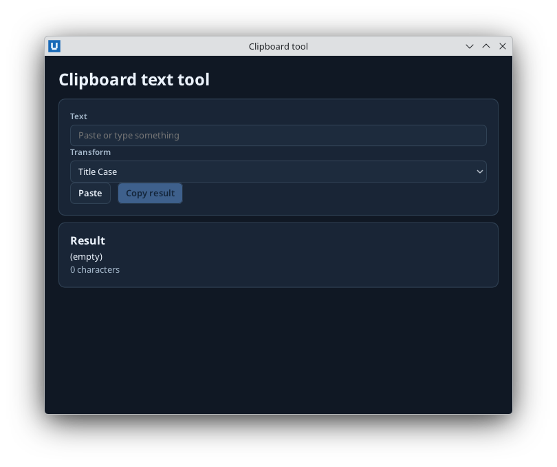 |
| [File inspector](file-picker.md) | Pick files with the native open dialog and list their sizes and a total. | 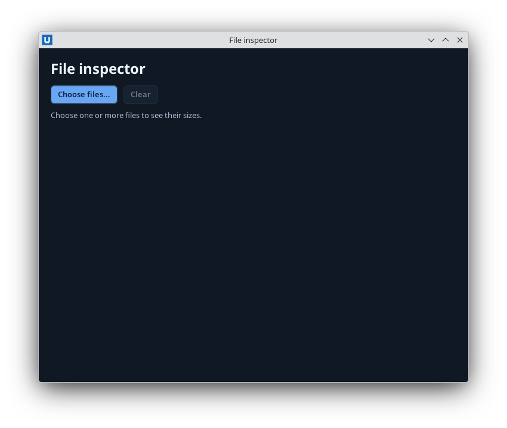 |
| [Notes with inspector windows](multi-window.md) | Several windows bound to the same state; open, track and close inspector windows. | 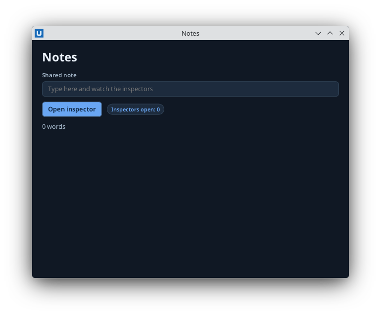 |
| [System dashboard](dashboard.md) | A responsive card grid with a live clock and disk usage, themed with extra CSS. | 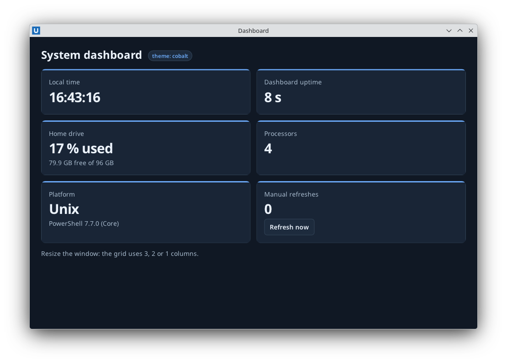 |
| [Theme preview](theme-preview.md) | Every component in a chosen theme and density, with an optional custom accent colour. | 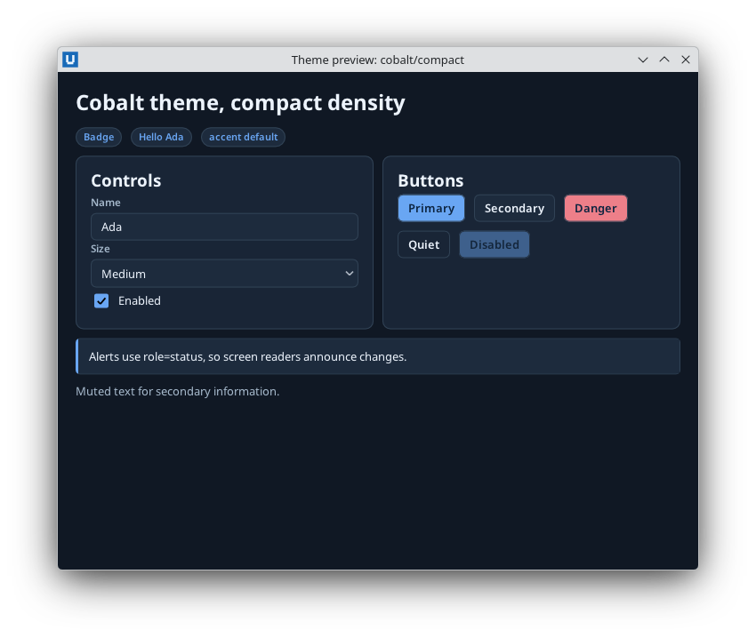 |
| [Message composer](message-preview.md) | Untrusted typed text is always escaped; only fixed help markup is inserted as HTML. | 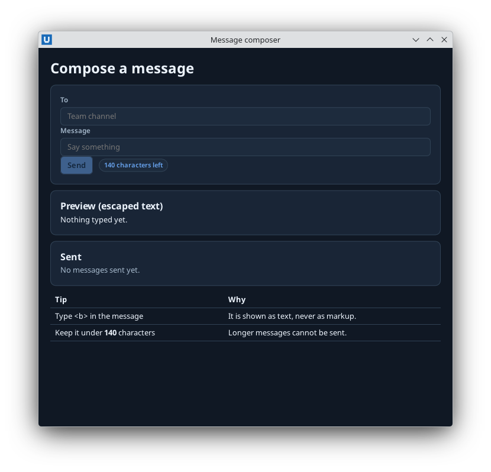 |
