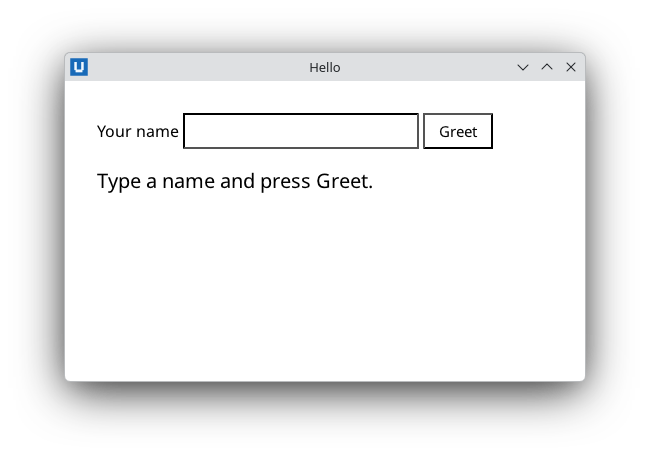

<!-- GENERATED by scripts/import-docs.py; edit the generator or the owning repository. -->
# Hello

The smallest complete app: a greeting form that writes untrusted text safely.

*Same example in PowerShell: [Hello](../../../powershell/sdk/examples/hello.md)*



*Real capture on KDE Plasma 6.6 Wayland with the released packages.*

**What it teaches:** application lifecycle; get_value; set_text.

## Run it

```bash
python hello.py
```

Related guide: [lifecycle](../guides/lifecycle.md)

## Source: `hello.py`

[View on GitHub](https://github.com/nativehtmlkit/nativehtmlkit-python/blob/main/examples/hello.py)

```python
"""Hello: the smallest complete NativeHTMLKit app, a greeting form.

What it teaches
  * the application lifecycle: ``Application.start`` -> window -> document -> events ->
    ``app.run()`` (which announces readiness and waits until the last window closes)
  * reading an input value with ``get_value``
  * writing untrusted text safely with ``set_text`` (it never parses HTML)

Run:  python examples/hello.py      (or: uv run examples/hello.py)
"""
from __future__ import annotations

from nativehtmlkit import Application, Document

PAGE = """<!doctype html>
<html><head><meta charset="utf-8"><style>
  body { font-family: system-ui, sans-serif; margin: 32px; }
  input { padding: 6px 8px; font-size: 15px; }
  button { padding: 6px 14px; font-size: 15px; }
  #greeting { margin-top: 18px; font-size: 20px; }
</style></head>
<body>
  <label for="name">Your name</label>
  <input id="name" autofocus>
  <button id="greet">Greet</button>
  <p id="greeting">Type a name and press Greet.</p>
</body></html>"""


def greet(document: Document) -> None:
    name = document.get_value("name").strip() or "world"
    # Text is never parsed as HTML: '<b>' typed by the user stays visible as '<b>'.
    document.set_text("greeting", f"Hello, {name}!")


def build(app: Application) -> Document:
    window = app.open_html(PAGE, title="Hello", width=520, height=300)
    document = window.document
    document.on("click", lambda _event: greet(document), element="greet")
    return document


def main() -> None:
    # Application.start() runs this script a second time as the host's backend.
    # Keep side effects inside main(), after start().
    with Application.start(name="Hello NativeHTMLKit") as app:
        build(app)
        app.run()   # until the user closes the last window


if __name__ == "__main__":
    main()
```
