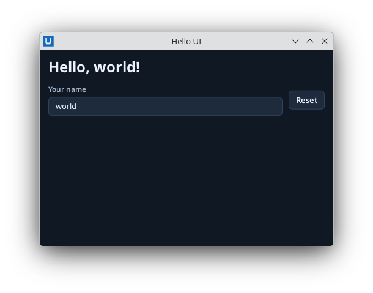

<!-- GENERATED by scripts/import-docs.py; edit the generator or the owning repository. -->
# Hello UI

The first window: a greeting that follows a text field, and a Reset button.

*Same example in PowerShell: [Hello UI](../../../powershell/ui/examples/hello.md)*



*Real capture on KDE Plasma 6.6 Wayland with the released packages.*

**What it teaches:** state and computed values; two-way input; button handler; application lifecycle.

## Run it

```bash
python hello.py
```

Related guide: [reactive state](../guides/reactive-state.md)

## Source: `python/hello.py`

[View on GitHub](https://github.com/nativehtmlkit/nativehtmlkit_ui/blob/main/examples/python/hello.py)

```python
"""Hello UI: the first window of the getting-started page.

Teaches: Application.start(), state() and computed(), a heading bound to a computed value, a
two-way input, a button that sets state, mount/run/dispose behind the script entry point.
Run:     python hello.py      (pip install nativehtmlkit_ui)
Guide:   docs/python/getting-started.md
"""
from nativehtmlkit import Application
from nativehtmlkit_ui import UI, computed, state


def main():
    with Application.start(name="Hello UI") as app:
        name = state("world")
        greeting = computed(lambda: f"Hello, {name.value}!")

        ui = UI(title="Hello UI", width=480, height=320)
        with ui.column():
            ui.heading(greeting, level=1)
            with ui.row():
                ui.input(name, label="Your name")
                ui.button("Reset", variant="secondary", on_click=lambda _event: name.set("world"))
        try:
            ui.mount(app)
            app.run()
        finally:
            ui.dispose()


if __name__ == "__main__":
    main()
```
