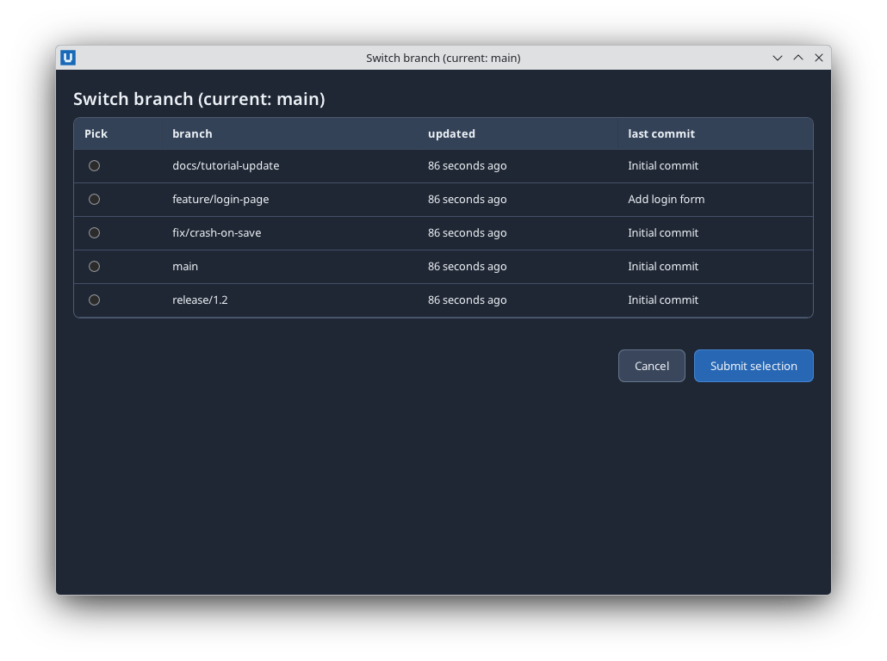

# Tutorial: a Git branch picker (CLI)

You will write **git-pick**, a Bash script that lists your local Git branches in a native window, switches to the one you pick, and can delete merged branches in a multi-select list. It shows how to use `nativehtmlkit select` safely in scripts: input formats, output, exit statuses and timeouts.



*Real capture on KDE Plasma 6.6 Wayland with Core 1.0.3 and CLI 0.1.2.*

**Time:** about 20 minutes. **You need:** Bash, Git, and the `nativehtmlkit` command on your `PATH` ([CLI in five minutes](../getting-started/cli.md)). Final code: [`examples/tutorials/cli-branch-picker/git-pick.sh`](https://github.com/nativehtmlkit/nativehtmlkit/blob/main/examples/tutorials/cli-branch-picker/git-pick.sh).

## Step 1: pick a branch

<!-- include: examples/tutorials/cli-branch-picker/step1-pick.sh -->
```bash title="examples/tutorials/cli-branch-picker/step1-pick.sh"
#!/usr/bin/env bash
# Branch picker tutorial, step 1: offer the local branches in a native list and report the choice.
#
# Teaches: piping lines into `nativehtmlkit select`, capturing stdout, and the exit statuses
#          0 (chosen), 2 (cancelled), 124 (--timeout expired) and anything else (error).
# Run:     bash step1-pick.sh [--timeout SECONDS]     (inside a Git work tree)
# Guide:   docs/tutorials/cli-branch-picker.md (step 1 of 2)
set -euo pipefail

status=0
choice=$(git for-each-ref --format='%(refname:short)' refs/heads/ \
  | nativehtmlkit select --title "Pick a branch" "$@") || status=$?

case $status in
  0) echo "You chose: $choice" ;;
  2) echo "Cancelled" >&2 ;;
  124) echo "No choice made in time" >&2 ;;
  *) echo "nativehtmlkit select failed with exit status $status" >&2 ;;
esac
exit "$status"
```
<!-- /include -->

Run it inside any Git work tree: `bash step1-pick.sh`.

- `git for-each-ref --format='%(refname:short)' refs/heads/` prints one branch per line, which is the default `lines` input format.
- `nativehtmlkit select` opens the window and blocks. On success it prints the chosen line and exits 0.
- `choice=$(...) || status=$?` keeps `set -e` from ending the script when the user cancels: the exit status is captured instead.
- `"$@"` passes extra options through, for example `bash step1-pick.sh --timeout 30`.

## Step 2: a table, switching, and deleting merged branches

<!-- include: examples/tutorials/cli-branch-picker/git-pick.sh -->
```bash title="examples/tutorials/cli-branch-picker/git-pick.sh"
#!/usr/bin/env bash
# git-pick: choose a local Git branch in a native window and switch to it (CLI tutorial final code).
#
# Teaches: feeding TSV to `nativehtmlkit select`, reading the selection from stdout, handling every
#          exit status (0 chosen, 2 cancelled, 124 timed out, anything else an error), multi-select
#          with --multi, and keeping the shell script safe with `set -euo pipefail`.
# Run:     bash git-pick.sh [--timeout SECONDS]                 switch to the chosen branch
#          bash git-pick.sh --delete-merged [--timeout SECONDS] delete chosen branches already merged
#          bash git-pick.sh --print                             show the table that would be offered
#          (inside a Git work tree; needs `nativehtmlkit` on PATH)
# Guide:   docs/tutorials/cli-branch-picker.md
set -euo pipefail

usage() {
  sed -n '2,11p' "$0" | sed 's/^# \{0,1\}//'
}

die() { echo "git-pick: $*" >&2; exit 1; }

mode=switch
select_options=()
while [ $# -gt 0 ]; do
  case "$1" in
    --timeout)
      [ $# -ge 2 ] || die "--timeout needs a number of seconds"
      select_options+=(--timeout "$2"); shift 2 ;;
    --delete-merged) mode=delete; shift ;;
    --print) mode=print; shift ;;
    -h|--help) usage; exit 0 ;;
    *) echo "git-pick: unknown option: $1 (try --help)" >&2; exit 64 ;;
  esac
done

command -v nativehtmlkit >/dev/null 2>&1 || die "nativehtmlkit is not on PATH (see the CLI install guide)"
git rev-parse --is-inside-work-tree >/dev/null 2>&1 || die "not inside a Git repository"
current=$(git symbolic-ref --quiet --short HEAD || echo "(detached HEAD)")

# One TSV row per branch, most recently committed first. The CLI treats a double quote as CSV/TSV
# quoting, so quotes in commit subjects are replaced by apostrophes.
branch_table() {
  printf 'branch\tupdated\tlast commit\n'
  git for-each-ref --sort=-committerdate \
    --format='%(refname:short)%09%(committerdate:relative)%09%(subject)' "$@" | tr '"' "'"
}

# Runs `nativehtmlkit select`, prints the chosen branch names (first column), returns its status.
pick() {
  local title=$1; shift
  local output status
  set +e
  output=$(nativehtmlkit select --input-format tsv --output-format lines --title "$title" \
    "${select_options[@]}" "$@")
  status=$?
  set -e
  case $status in
    0) printf '%s\n' "$output" | cut -f1 ;;
    2) echo "git-pick: cancelled; nothing changed" >&2 ;;
    124) echo "git-pick: no choice made in time; nothing changed" >&2 ;;
    *) echo "git-pick: nativehtmlkit select failed with exit status $status" >&2 ;;
  esac
  return $status
}

case $mode in
  print)
    branch_table refs/heads/
    ;;
  switch)
    branch=$(branch_table refs/heads/ | pick "Switch branch (current: $current)") || exit $?
    [ -n "$branch" ] || die "no branch selected"
    if [ "$branch" = "$current" ]; then
      echo "Already on $branch"
    else
      git switch --quiet -- "$branch"
      echo "Switched to $branch"
    fi
    ;;
  delete)
    if [ -z "$(git for-each-ref --merged HEAD --format='%(refname:short)' refs/heads/ | grep -vxF -- "$current" || true)" ]; then
      echo "No merged branches to delete"
      exit 0
    fi
    # Offer every merged branch except the one you are on (row 1 is the header).
    chosen=$(branch_table --merged HEAD refs/heads/ | awk -F'\t' -v current="$current" 'NR == 1 || $1 != current' \
      | pick "Delete merged branches" --multi) || exit $?
    while IFS= read -r branch; do
      if [ -n "$branch" ]; then
        git branch --quiet -d -- "$branch"
        echo "Deleted $branch"
      fi
    done <<< "$chosen"
    ;;
esac
```
<!-- /include -->

- `branch_table` prints **TSV** with a header row (`branch`, `updated`, `last commit`), and `--input-format tsv` shows it as a table with columns. The CLI treats `"` as CSV/TSV quoting, so quotes in commit subjects are replaced.
- `--output-format lines` prints each selected row as its cells joined by tabs, without the header; `cut -f1` keeps the branch name.
- `pick` turns every exit status into a clear message and returns it unchanged, and `|| exit $?` makes the script exit with the same status: 2 when cancelled, 124 when `--timeout` expired.
- `--delete-merged` offers only branches merged into `HEAD` (minus the current one) and passes `--multi`, so the user can tick several rows. Each is deleted with `git branch -d`, which refuses anything not merged.
- `--print` shows the table without opening a window, useful when you change the format.

Try it:

```bash
bash git-pick.sh                 # switch branch
bash git-pick.sh --timeout 20    # give up after 20 seconds (exit status 124)
bash git-pick.sh --delete-merged # tidy up
```

Make it a Git command by saving it as `git-pick` somewhere on your `PATH` and marking it executable; then `git pick` works.

## What you learned

- Feed `lines` or `tsv` input, read `lines` output, and keep stdout trustworthy: it is only written on success.
- Handle 0, 2, 124 and other exit statuses explicitly under `set -euo pipefail`.
- Use `--multi` and `--timeout`.

## Where next

- `nativehtmlkit form` collects several values at once from trusted HTML; see the [CLI reference](https://github.com/nativehtmlkit/nativehtmlkit-cli/blob/main/docs/REFERENCE.md).
- For anything more interactive than one decision, use the [Python](../getting-started/python.md) or [PowerShell](../getting-started/powershell.md) SDK.
