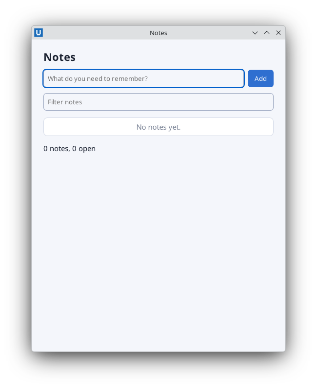

# Tutorial: a notes app with persistence (Python SDK)

You will build **Notes**: a window where you add short notes, mark them done, delete them, filter them, and find them again the next time you start the app. Along the way you learn the core pattern of every NativeHTMLKit SDK app: *keep the data in Python, render it into the page, react to events*.



*Real capture on KDE Plasma 6.6 Wayland with Core 1.0.3 and Python SDK 0.1.2.*

**Time:** about 30 minutes. **You need:** the Python SDK installed and a first window working ([Python SDK in five minutes](../getting-started/python.md)). Final code: [`examples/tutorials/python-notes/notes.py`](https://github.com/nativehtmlkit/nativehtmlkit/blob/main/examples/tutorials/python-notes/notes.py).

## Step 1: a window that renders Python data

Start with a page that has an empty `<ul id="notes">`, and fill it from a Python list.

<!-- include: examples/tutorials/python-notes/step1_window.py -->
```python title="examples/tutorials/python-notes/step1_window.py"
"""Notes tutorial, step 1: open a native window and render a list from Python data.

Teaches: Application.start(), open_html(), building HTML from data with html.escape(), app.run().
Run:     python step1_window.py
Guide:   docs/tutorials/python-notes.md (step 1 of 4)
"""
import html

from nativehtmlkit import Application

PAGE = """<!doctype html>
<html><head><meta charset="utf-8"><style>
  body { font: 15px sans-serif; margin: 0; background: #f4f6fb; color: #1d2433; }
  main { padding: 20px 24px; }
  h1 { font-size: 22px; margin: 0 0 12px; }
  ul { list-style: none; padding: 0; margin: 0; }
  li { background: white; border: 1px solid #d5dbe8; border-radius: 8px; padding: 10px 12px; margin: 6px 0; }
  .done { color: #7a8396; text-decoration: line-through; }
</style></head>
<body><main>
  <h1>Notes</h1>
  <ul id="notes"></ul>
</main></body></html>"""

SAMPLE_NOTES = [
    {"id": 1, "text": "Read the NativeHTMLKit tutorial", "done": True},
    {"id": 2, "text": "Build a notes app", "done": False},
]


def render_note(note):
    css = "note done" if note["done"] else "note"
    return f'<li class="{css}" id="note-{note["id"]}">{html.escape(note["text"])}</li>'


def main():
    with Application.start(name="Notes") as app:
        window = app.open_html(PAGE, title="Notes", width=520, height=600)
        window.document.replace_html("notes", "".join(render_note(n) for n in SAMPLE_NOTES))
        app.run()


if __name__ == "__main__":
    main()
```
<!-- /include -->

Run it with `python step1_window.py`. Things to notice:

- The page is an ordinary HTML string with a `<style>` block. The renderer supports a large, documented CSS subset (flexbox, grid, custom properties and more; see [Style with the supported CSS](../how-to/styling.md)), but no JavaScript.
- `render_note()` turns one note into HTML. **Every piece of user text goes through `html.escape()`** before it becomes markup. Later, notes come from the keyboard; without escaping, a note like `<b>` would change your page.
- `replace_html("notes", ...)` replaces the children of the element with id `notes`. Ids are how Python points at parts of the page.
- Everything happens inside `main()` after `Application.start()`, because the host runs this file a second time as its backend ([why](../concepts/lifecycle.md)).

## Step 2: add notes with a form

A `<form>` gives you validation and keyboard behaviour for free: pressing Enter in the field submits it, and `required` stops empty submissions before your code sees them.

<!-- include: examples/tutorials/python-notes/step2_add.py -->
```python title="examples/tutorials/python-notes/step2_add.py"
"""Notes tutorial, step 2: add notes with a form.

Teaches: an HTML <form> with a required field, the "submit" event, reading a control with
get_value(), appending escaped HTML with insert_html(), clearing and focusing the field.
Run:     python step2_add.py
Guide:   docs/tutorials/python-notes.md (step 2 of 4)
"""
import html

from nativehtmlkit import Application

PAGE = """<!doctype html>
<html><head><meta charset="utf-8"><style>
  body { font: 15px sans-serif; margin: 0; background: #f4f6fb; color: #1d2433; }
  main { padding: 20px 24px; }
  h1 { font-size: 22px; margin: 0 0 12px; }
  form { display: flex; gap: 8px; margin-bottom: 12px; }
  input { flex: 1; padding: 8px; border: 1px solid #9aa6bf; border-radius: 6px; }
  button { padding: 8px 14px; border: 0; border-radius: 6px; background: #2f6fd0; color: white; }
  ul { list-style: none; padding: 0; margin: 0; }
  li { background: white; border: 1px solid #d5dbe8; border-radius: 8px; padding: 10px 12px; margin: 6px 0; }
</style></head>
<body><main>
  <h1>Notes</h1>
  <form id="add-form">
    <input id="new-note" name="text" required maxlength="200" placeholder="What do you need to remember?"
           aria-label="New note">
    <button id="add">Add</button>
  </form>
  <ul id="notes"></ul>
  <p id="summary">0 notes</p>
</main></body></html>"""


def main():
    with Application.start(name="Notes") as app:
        window = app.open_html(PAGE, title="Notes", width=520, height=600)
        doc = window.document
        notes = []

        def add_note(_event):
            # The form only submits when its "required" field is filled in.
            text = doc.get_value("new-note").strip()
            if not text:
                return
            notes.append(text)
            doc.insert_html("notes", f"<li>{html.escape(text)}</li>")  # never insert raw user text
            doc.set_text("summary", f"{len(notes)} notes")
            doc.set_value("new-note", "")
            doc.focus("new-note")

        doc.on("submit", add_note, element="add-form")
        doc.focus("new-note")
        app.run()


if __name__ == "__main__":
    main()
```
<!-- /include -->

- `doc.on("submit", add_note, element="add-form")` runs `add_note` when the form is submitted, by Enter or by the button. The host validates first: with an empty field there is no `submit` event at all.
- Event callbacks get one argument, the event dictionary. This handler does not need it, so it is named `_event`.
- `get_value("new-note")` reads what the user typed; `insert_html(..., "<li>...</li>")` appends to the list (position `beforeend` by default).
- `set_value("new-note", "")` clears the field and `focus("new-note")` puts the cursor back, so you can type the next note immediately.

## Step 3: done and delete buttons

Each note now gets two buttons. Instead of subscribing once per button (and again whenever the list changes), subscribe **once** on the list and look at which element was clicked.

<!-- include: examples/tutorials/python-notes/step3_actions.py -->
```python title="examples/tutorials/python-notes/step3_actions.py"
"""Notes tutorial, step 3: mark notes done and delete them.

Teaches: keeping the data model in Python and re-rendering the list from it, one delegated "click"
handler for many buttons (event["element"] is the id of the clicked element), stable element ids.
Run:     python step3_actions.py
Guide:   docs/tutorials/python-notes.md (step 3 of 4)
"""
import html

from nativehtmlkit import Application

PAGE = """<!doctype html>
<html><head><meta charset="utf-8"><style>
  body { font: 15px sans-serif; margin: 0; background: #f4f6fb; color: #1d2433; }
  main { padding: 20px 24px; }
  h1 { font-size: 22px; margin: 0 0 12px; }
  form { display: flex; gap: 8px; margin-bottom: 12px; }
  input { flex: 1; padding: 8px; border: 1px solid #9aa6bf; border-radius: 6px; }
  button { padding: 8px 14px; border: 0; border-radius: 6px; background: #2f6fd0; color: white; }
  ul { list-style: none; padding: 0; margin: 0; }
  li { display: flex; align-items: center; gap: 8px; background: white; border: 1px solid #d5dbe8;
       border-radius: 8px; padding: 8px 12px; margin: 6px 0; }
  li .text { flex: 1; }
  li.done .text { color: #7a8396; text-decoration: line-through; }
  li button { padding: 4px 10px; background: #e3e8f3; color: #1d2433; }
  li button.danger { background: #f6dede; color: #8a1f1f; }
</style></head>
<body><main>
  <h1>Notes</h1>
  <form id="add-form">
    <input id="new-note" name="text" required maxlength="200" placeholder="What do you need to remember?"
           aria-label="New note">
    <button id="add">Add</button>
  </form>
  <ul id="notes"></ul>
  <p id="summary"></p>
</main></body></html>"""


def render_note(note):
    css = "done" if note["done"] else ""
    label = "Undo" if note["done"] else "Done"
    return (f'<li class="{css}" id="note-{note["id"]}">'
            f'<span class="text">{html.escape(note["text"])}</span>'
            f'<button id="done-{note["id"]}">{label}</button>'
            f'<button id="delete-{note["id"]}" class="danger">Delete</button></li>')


def main():
    with Application.start(name="Notes") as app:
        window = app.open_html(PAGE, title="Notes", width=520, height=600)
        doc = window.document
        notes = []

        def refresh():
            doc.replace_html("notes", "".join(render_note(n) for n in notes))
            remaining = sum(1 for n in notes if not n["done"])
            doc.set_text("summary", f"{len(notes)} notes, {remaining} open")

        def add_note(_event):
            text = doc.get_value("new-note").strip()
            if not text:
                return
            next_id = max((n["id"] for n in notes), default=0) + 1
            notes.append({"id": next_id, "text": text, "done": False})
            refresh()
            doc.set_value("new-note", "")
            doc.focus("new-note")

        def list_clicked(event):
            # One handler for every button in the list: "done-3" or "delete-3".
            action, _, note_id = (event.get("element") or "").partition("-")
            note = next((n for n in notes if str(n["id"]) == note_id), None)
            if note is None:
                return
            if action == "done":
                note["done"] = not note["done"]
            elif action == "delete":
                notes.remove(note)
            refresh()

        doc.on("submit", add_note, element="add-form")
        doc.on("click", list_clicked, element="notes")
        refresh()
        app.run()


if __name__ == "__main__":
    main()
```
<!-- /include -->

- Notes are dictionaries with a stable `id`. Button ids encode the action and the note: `done-3`, `delete-3`.
- `doc.on("click", list_clicked, element="notes")` is a *delegated* handler: it fires for clicks anywhere inside `#notes`. `event["element"]` is the id of the nearest element with an id that was clicked, and `event["path"]` lists the ids from there up to the document.
- The handler changes the Python list, then `refresh()` renders the whole list again. For lists of this size, re-rendering is simple and fast, and the model in Python stays the single source of truth.
- Clicking the note text itself yields `note-3`, which the handler ignores.

## Step 4: save to a file and filter

The final version keeps notes in a JSON file, loads them at start, and adds a live filter.

<!-- include: examples/tutorials/python-notes/notes.py -->
```python title="examples/tutorials/python-notes/notes.py"
"""Notes: a small persistent notes app built with the NativeHTMLKit Python SDK (tutorial final code).

Teaches: a form with validation and the "submit" event, a delegated "click" handler, a live
"input" filter, re-rendering escaped HTML from a Python model, and saving the model to a JSON file
with an atomic replace.
Run:     python notes.py [NOTES_FILE]
         (default file: .nativehtmlkit-notes.json in your home directory)
Guide:   docs/tutorials/python-notes.md (step 4 of 4)
"""
import html
import json
import os
import sys
import tempfile
from pathlib import Path

from nativehtmlkit import Application

PAGE = """<!doctype html>
<html><head><meta charset="utf-8"><style>
  body { font: 15px sans-serif; margin: 0; background: #f4f6fb; color: #1d2433; }
  main { padding: 20px 24px; }
  h1 { font-size: 22px; margin: 0 0 12px; }
  form { display: flex; gap: 8px; margin-bottom: 12px; }
  input { padding: 8px; border: 1px solid #9aa6bf; border-radius: 6px; }
  #new-note { flex: 1; }
  #filter { width: 100%; box-sizing: border-box; margin-bottom: 8px; }
  button { padding: 8px 14px; border: 0; border-radius: 6px; background: #2f6fd0; color: white; }
  ul { list-style: none; padding: 0; margin: 0; }
  li { display: flex; align-items: center; gap: 8px; background: white; border: 1px solid #d5dbe8;
       border-radius: 8px; padding: 8px 12px; margin: 6px 0; }
  li .text { flex: 1; }
  li.done .text { color: #7a8396; text-decoration: line-through; }
  li.empty { color: #7a8396; justify-content: center; }
  li button { padding: 4px 10px; background: #e3e8f3; color: #1d2433; }
  li button.danger { background: #f6dede; color: #8a1f1f; }
  #status { color: #8a1f1f; min-height: 1.2em; }
</style></head>
<body><main>
  <h1>Notes</h1>
  <form id="add-form">
    <input id="new-note" name="text" required maxlength="200" placeholder="What do you need to remember?"
           aria-label="New note">
    <button id="add">Add</button>
  </form>
  <input id="filter" type="search" placeholder="Filter notes" aria-label="Filter notes">
  <ul id="notes"></ul>
  <p id="summary"></p>
  <p id="status" role="status"></p>
</main></body></html>"""


class NoteStore:
    """Loads and saves the notes list as JSON. A save never leaves a half-written file."""

    def __init__(self, path: Path):
        self.path = path

    def load(self) -> list:
        try:
            data = json.loads(self.path.read_text(encoding="utf-8"))
        except FileNotFoundError:
            return []
        return [{"id": int(n["id"]), "text": str(n["text"]), "done": bool(n["done"])}
                for n in data.get("notes", [])]

    def save(self, notes: list) -> None:
        self.path.parent.mkdir(parents=True, exist_ok=True)
        fd, temporary = tempfile.mkstemp(prefix=".notes-", dir=self.path.parent)
        try:
            with os.fdopen(fd, "w", encoding="utf-8") as stream:
                json.dump({"version": 1, "notes": notes}, stream, indent=2)
            os.replace(temporary, self.path)
        except BaseException:
            os.unlink(temporary)
            raise


def render_note(note):
    css = "done" if note["done"] else ""
    label = "Undo" if note["done"] else "Done"
    return (f'<li class="{css}" id="note-{note["id"]}">'
            f'<span class="text">{html.escape(note["text"])}</span>'
            f'<button id="done-{note["id"]}">{label}</button>'
            f'<button id="delete-{note["id"]}" class="danger">Delete</button></li>')


def main():
    # Application.start() runs this script twice; everything with side effects comes after it.
    with Application.start(name="Notes") as app:
        path = Path(sys.argv[1]) if len(sys.argv) > 1 else Path.home() / ".nativehtmlkit-notes.json"
        store = NoteStore(path)
        window = app.open_html(PAGE, title="Notes", width=520, height=640)
        doc = window.document
        try:
            notes = store.load()
        except (OSError, ValueError, KeyError, TypeError) as error:
            notes = []
            doc.set_text("status", f"Could not read {path.name}: {error}")

        def refresh():
            needle = doc.get_value("filter").strip().casefold()
            shown = [n for n in notes if needle in n["text"].casefold()]
            empty = '<li class="empty">No matching notes.</li>' if notes else '<li class="empty">No notes yet.</li>'
            doc.replace_html("notes", "".join(render_note(n) for n in shown) or empty)
            remaining = sum(1 for n in notes if not n["done"])
            doc.set_text("summary", f"{len(notes)} notes, {remaining} open")

        def save():
            try:
                store.save(notes)
                doc.set_text("status", "")
            except OSError as error:
                doc.set_text("status", f"Not saved: {error.strerror}")

        def add_note(_event):
            text = doc.get_value("new-note").strip()
            if not text:
                return
            next_id = max((n["id"] for n in notes), default=0) + 1
            notes.append({"id": next_id, "text": text, "done": False})
            save()
            refresh()
            doc.set_value("new-note", "")
            doc.focus("new-note")

        def list_clicked(event):
            action, _, note_id = (event.get("element") or "").partition("-")
            note = next((n for n in notes if str(n["id"]) == note_id), None)
            if note is None:
                return
            if action == "done":
                note["done"] = not note["done"]
            elif action == "delete":
                notes.remove(note)
            else:
                return
            save()
            refresh()

        doc.on("submit", add_note, element="add-form")
        doc.on("click", list_clicked, element="notes")
        doc.on("input", lambda _event: refresh(), element="filter")
        refresh()
        doc.focus("new-note")
        app.run()


if __name__ == "__main__":
    main()
```
<!-- /include -->

- `NoteStore.save()` writes to a temporary file in the same folder and then `os.replace()`s the real file, so a crash never leaves half a file behind.
- The file path is the first command-line argument, or `.nativehtmlkit-notes.json` in your home folder: `python notes.py ~/work-notes.json`. Arguments survive the re-execution by the host.
- A read error does not stop the app: it starts empty and shows the reason in `#status`.
- `doc.on("input", ..., element="filter")` fires on every keystroke in the search field; `refresh()` reads the filter with `get_value()` and renders only matching notes.
- `#status` has `role="status"`, so screen readers announce save errors ([Accessibility basics](../how-to/accessibility.md)).

## What you learned

- Build pages as HTML strings, escape every untrusted value, address elements by id.
- Use a form and the `submit` event for input; let the host validate `required` fields.
- Use one delegated handler for many buttons, and re-render from a Python model.
- Persist with an atomic file replace, and take settings from the command line.

## Where next

- [Update the page](../how-to/update-the-page.md): `batch()`, classes and attributes instead of re-rendering everything.
- [Build and validate forms](../how-to/forms.md): custom validation messages and `form_data()`.
- [HTML dialogs](../how-to/html-dialogs.md): ask "Delete all notes?" before clearing the list.
- [Distribute your app](../how-to/distribute.md): package Notes for other people.
