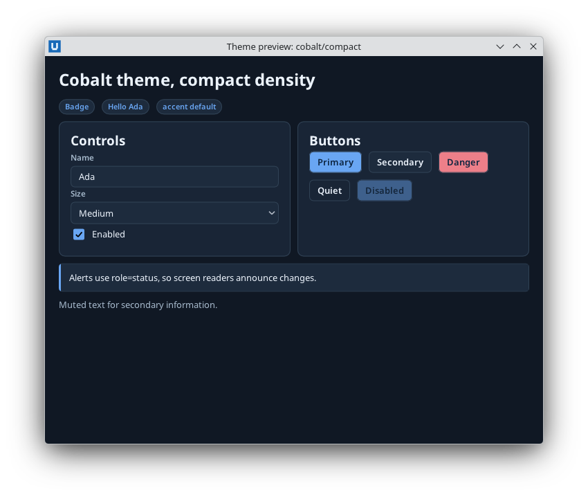

<!-- GENERATED by scripts/import-docs.py; edit the generator or the owning repository. -->
# Theme preview

Every component in a chosen theme and density, with an optional custom accent colour.

*Same example in Python: [Theme preview](../../python/examples/theme-preview.md)*



*Real capture on KDE Plasma 6.6 Wayland with the released packages.*

**What it teaches:** themes and densities; overriding design tokens with extra CSS; several instances side by side.

## Run it

```powershell
pwsh -File ./theme_preview.ps1 [cobalt|graphite|daylight] [compact|regular|comfortable] [#RRGGBB]
```

Related guide: [theming and custom css](../guides/theming-and-custom-css.md)

## Source: `powershell/theme_preview.ps1`

[View on GitHub](https://github.com/nativehtmlkit/nativehtmlkit_ui/blob/main/examples/powershell/theme_preview.ps1)

```powershell
# Theme preview: try the UI module's themes, densities and a custom accent colour.
#
# Teaches: New-NHKUi -Theme/-Density/-ExtraCss, overriding the module's CSS custom properties
#          (--nhk-accent and friends) for one theme, and the main components side by side.
#          -Instance multiple lets you start several previews at once and compare them.
# Run:     pwsh -File ./theme_preview.ps1 [cobalt|graphite|daylight] [compact|regular|comfortable] [#RRGGBB]
#          powershell.exe -NoProfile -File .\theme_preview.ps1 daylight comfortable '#0f7b6c'
# Guide:   docs/powershell/guides/theming-and-custom-css.md
param([string]$Theme = 'cobalt', [string]$Density = 'compact', [string]$Accent = '')
$ErrorActionPreference = 'Stop'
Import-Module NativeHTMLKit.UI
$app = Start-NativeHTMLKitScript -Name 'Theme preview' -Instance multiple

if (@('cobalt', 'graphite', 'daylight') -notcontains $Theme) { $Theme = 'cobalt' }
if (@('compact', 'regular', 'comfortable') -notcontains $Density) { $Density = 'compact' }
if ($Accent -notmatch '^#[0-9A-Fa-f]{6}$') { $Accent = '' }
# -ExtraCss is appended after the module stylesheet, so the same selector wins.
$css = ''
if ($Accent) { $css = "body.nhk-theme-$Theme { --nhk-accent: $Accent; --nhk-accent-strong: $Accent; --nhk-focus: $Accent; }" }

$s = @{ Name = (New-NHKUiState -Value 'Ada'); Enabled = (New-NHKUiState -Value $true)
        Size = (New-NHKUiState -Value 'm'); Always = (New-NHKUiState -Value $true) }
$s.Hello = New-NHKUiComputed -DependsOn @($s.Name) -Data $s -Compute { param($s) 'Hello ' + $s.Name.Value }
$accentText = if ($Accent) { $Accent } else { 'default' }
$themeTitle = $Theme.Substring(0, 1).ToUpperInvariant() + $Theme.Substring(1)

$ui = New-NHKUi -Title "Theme preview: $Theme/$Density" -Theme $Theme -Density $Density -ExtraCss $css -Width 720 -Height 560
$null = Add-NHKUiColumn -UI $ui -Content {
    $null = Add-NHKUiHeading -UI $ui -Text "$themeTitle theme, $Density density" -Level 1
    $null = Add-NHKUiRow -UI $ui -Content {
        $null = Add-NHKUiBadge -UI $ui -Text 'Badge'
        $null = Add-NHKUiBadge -UI $ui -Bind $s.Hello
        $null = Add-NHKUiBadge -UI $ui -Text "accent $accentText"
    }
    $null = Add-NHKUiGrid -UI $ui -Content {
        $null = Add-NHKUiCard -UI $ui -Content {
            $null = Add-NHKUiHeading -UI $ui -Text 'Controls' -Level 2
            $null = Add-NHKUiInput -UI $ui -Bind $s.Name -Label 'Name'
            $null = Add-NHKUiSelect -UI $ui -Bind $s.Size -Label 'Size' -Options @(
                @{ Value = 's'; Label = 'Small' }, @{ Value = 'm'; Label = 'Medium' }, @{ Value = 'l'; Label = 'Large' })
            $null = Add-NHKUiCheckbox -UI $ui -Bind $s.Enabled -Label 'Enabled'
        }
        $null = Add-NHKUiCard -UI $ui -Content {
            $null = Add-NHKUiHeading -UI $ui -Text 'Buttons' -Level 2
            $null = Add-NHKUiRow -UI $ui -Content {
                $null = Add-NHKUiButton -UI $ui -Text 'Primary'
                $null = Add-NHKUiButton -UI $ui -Text 'Secondary' -Variant secondary
                $null = Add-NHKUiButton -UI $ui -Text 'Danger' -Variant danger
                $null = Add-NHKUiButton -UI $ui -Text 'Quiet' -Variant quiet
                $null = Add-NHKUiButton -UI $ui -Text 'Disabled' -DisabledState $s.Always
            }
        }
    }
    $null = Add-NHKUiAlert -UI $ui -Text 'Alerts use role=status, so screen readers announce changes.'
    $null = Add-NHKUiText -UI $ui -Text 'Muted text for secondary information.' -Muted
}

try {
    $null = Start-NHKUi -UI $ui -Application $app
    Wait-NativeHTMLKit -Application $app -UntilShutdown
} finally {
    Stop-NHKUi -UI $ui
    $s.Hello.Dispose()
    Close-NativeHTMLKit -Application $app
}
```
